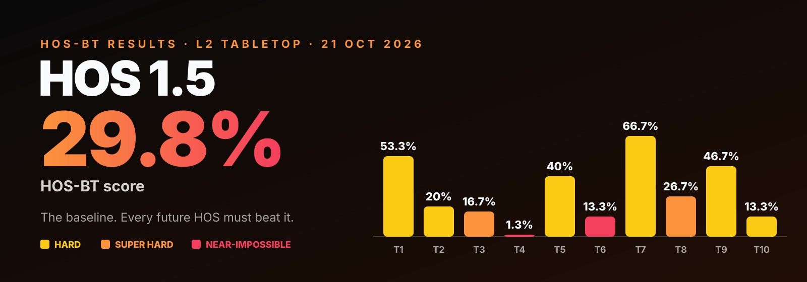

  

# HOS 1.5: HOS-BT Results

> **HOS 1.5 scored 29.8%.** It is the first HOS model tested on HOS-BT, so this is the baseline that HOS X and HOS 2.0 must beat.

| | |
| --- | --- |
| **Model** | HOS 1.5 (released 11 October 2026) |
| **Level** | L2 Tabletop, real hardware |
| **Test date** | 21 October 2026 |
| **HOS-BT version** | 1.0 |
| **Scores revised** | 24 November 2026 |
| **Final score** | **29.8%** |
| **Cost** | About $0.001 per task |
| **Speed** | About 1 minute per task |

---

## Final scores

| # | Task | Difficulty | Score |
| :-: | --- | :-: | :-: |
| T1 | Sweeping | Hard | **53.3%** |
| T2 | Mopping | Hard | **20%** |
| T3 | Washing utensils | Super hard | **16.7%** |
| T4 | Cooking | Near-impossible | **1.3%** |
| T5 | Washing clothes by machine | Hard | **40%** |
| T6 | Folding and ironing clothes | Near-impossible | **13.3%** |
| T7 | Sorting clothes into black and white | Hard | **66.7%** |
| T8 | Cleaning the bathroom and toilet | Super hard | **26.7%** |
| T9 | Dusting furniture and surfaces | Hard | **46.7%** |
| T10 | Tidying up the board | Hard | **13.3%** |
| | **HOS-BT score** | | **29.8%** |

### By difficulty

| Difficulty | Tasks | Average |
| --- | --- | :-: |
| Hard | T1, T2, T5, T7, T9, T10 | **40.0%** |
| Super hard | T3, T8 | **21.7%** |
| Near-impossible | T4, T6 | **7.3%** |

**Best:** T7 Sorting clothes, the top score at **66.7%**.
**Hardest:** T4 Cooking, just **1.3%**.

---

## What we learned

| Area | Result |
| --- | --- |
| **Perception** | Almost no mistakes: about 0 to 1 errors per task. |
| **Execution** | Compared with the dot simulation (counted as 100%), full physical execution reached about 10% on simple tasks and 2% on difficult tasks. |
| **Safety** | The robot sometimes jammed or got stuck. |
| **Speed** | About 1 minute per task on average. |
| **Human help** | Needed for positioning. |
| **ERR self-check** | ERR's verdict matched the real result 80% of the time. |

**The takeaway:** HOS 1.5 sees the scene well. The gap is in the physical world: moving precisely, without jamming, without a human placing things. That is exactly what HOS X and HOS 2.0 must close.

---

## Setup

| Item | Version |
| --- | --- |
| HOS software | S1.5-SRC |
| Hardware and firmware | HOS-Trigonometry and Shell 1.5 |
| Planner model | GPT-6-luna |

---

  <b>Next up: HOS X (December 2026) and HOS 2.0 (late January or early February 2027).</b> 
  <a href="README.md">How scores are calculated</a> · <a href="../README.md">HOS-BT benchmark</a> · <a href="../Benchmarking-tasks.md">All tasks</a>

