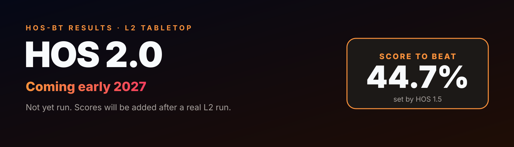

  

# HOS 2.0: HOS-BT Results

> **Not yet run.** HOS 2.0 will be tested on HOS-BT after it launches. The score to beat is **44.7%**, set by HOS 1.5.

| | |
| --- | --- |
| **Model** | HOS 2.0 |
| **Status** | Planned for late January or early February 2027 |
| **Level** | L2 Tabletop, real hardware |
| **HOS-BT version** | 1.0 |
| **Final score** | Not yet run |
| **Score to beat** | **44.7%** (HOS 1.5) |

---

## Final scores

| # | Task | Difficulty | HOS 1.5 | HOS 2.0 |
| :-: | --- | :-: | :-: | :-: |
| T1 | Sweeping | Hard | 80% | Not yet run |
| T2 | Mopping | Hard | 30% | Not yet run |
| T3 | Washing utensils | Super hard | 25% | Not yet run |
| T4 | Cooking | Near-impossible | 2% | Not yet run |
| T5 | Washing clothes by machine | Hard | 60% | Not yet run |
| T6 | Folding and ironing clothes | Near-impossible | 20% | Not yet run |
| T7 | Sorting clothes into black and white | Hard | 100% | Not yet run |
| T8 | Cleaning the bathroom and toilet | Super hard | 40% | Not yet run |
| T9 | Dusting furniture and surfaces | Hard | 70% | Not yet run |
| T10 | Tidying up the board | Hard | 20% | Not yet run |
| | **HOS-BT score** | | **44.7%** | Not yet run |

Scores will be added here only after a real, logged L2 run.

---

  <a href="HOS-1.5.md">HOS 1.5 results</a> · <a href="README.md">How scores are calculated</a> · <a href="../README.md">HOS-BT benchmark</a> · <a href="../Benchmarking-tasks.md">All tasks</a>

