<p align="center">
  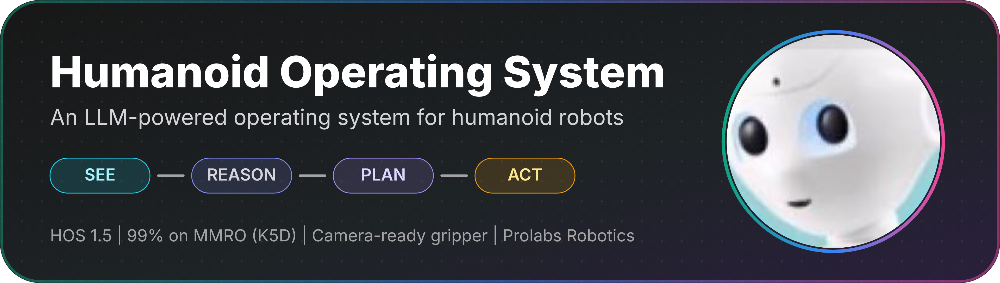
</p>

<p align="center">
  <a href="https://github.com/Aarav-111/Humanoid-Operating-System#recent-updates"></a>
  <a href="https://github.com/Aarav-111/Humanoid-Operating-System#benchmarking"></a>
  <a href="https://github.com/Aarav-111/Humanoid-Operating-System#camera-ready-gripper"></a>
  <a href="https://github.com/Aarav-111/Humanoid-Operating-System/tree/main/Software"></a>
  <a href="https://github.com/Aarav-111/Humanoid-Operating-System/tree/main/Hardware/Firmware"></a>
  <a href="https://github.com/Aarav-111/Humanoid-Operating-System/blob/main/LICENSE"></a>
</p>

<p align="center">
  <b>Demo Videos</b> &nbsp;|&nbsp; <b>Camera-Ready Gripper</b> &nbsp;|&nbsp; <b>Architecture</b> &nbsp;|&nbsp; <b>Navigate</b> &nbsp;|&nbsp; <b>Roadmap</b> &nbsp;|&nbsp; <b>Running Cost</b> &nbsp;|&nbsp; <b>Run It</b> &nbsp;|&nbsp; <b>Team</b>
</p>

---

## Overview

> An LLM-powered control layer and modular operating system for humanoid robots.

Jensen Huang has spoken about the need for a general-purpose robot breakthrough before humanoids can scale. HOS is our attempt at that: a foundational software and hardware framework that gives humanoid robots a generalized, reasoning-driven "mind."

Instead of training isolated models per task (the approach used by most VLA models, including Gemini Robotics and pi0.5), HOS uses an LLM-driven control layer for multi-modal decision-making. This repository covers the full HOS system: the mobile base for locomotion and the robotic arm for manipulation.

<p align="center">
  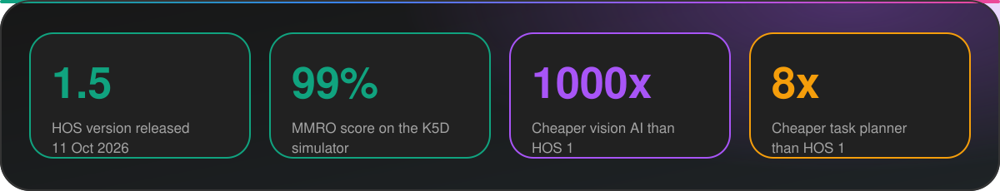
</p>


**Status:** HOS 1.5 released (11 October 2026). Active research and prototyping continue. Built by Prolabs Robotics, Bengaluru, India.

---

## Demo Videos

<table align="center">
  <tr>
    <td align="center" width="50%">
      <a href="https://www.youtube.com/watch?v=wpmh6HE-oz8">
        
      </a>
      <br><b>HOS 1.5 task compilation</b><br>11 October 2026
    </td>
    <td align="center" width="50%">
      <a href="https://youtu.be/9Af5JZoZxco">
        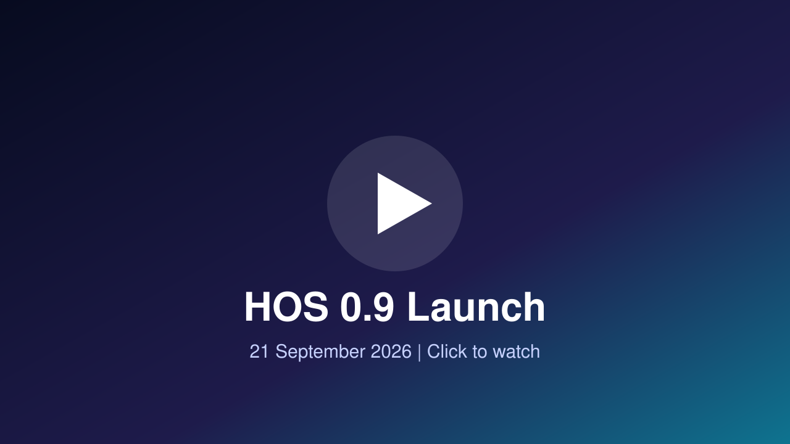
      </a>
      <br><b>HOS 0.9 launch</b><br>21 September 2026
    </td>
  </tr>
</table>

---

## Camera-Ready Gripper

We are introducing the **camera-ready gripper**, a super precise gripper built for **automatic pickup**.

<p align="center">
  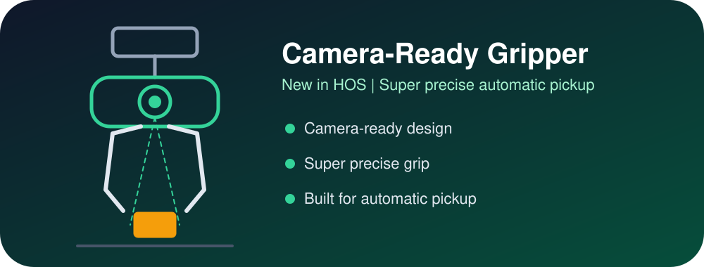
</p>

<p align="center">
  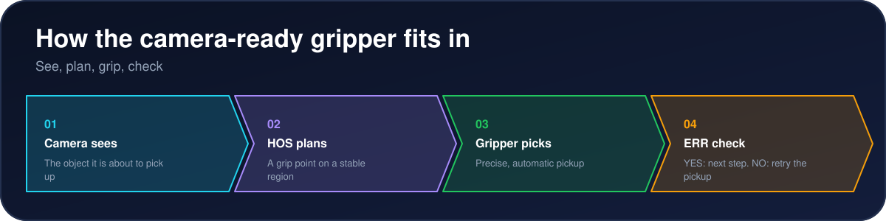
</p>


Full specs, STL files, and setup notes will be added to the [Hardware](https://github.com/Aarav-111/Humanoid-Operating-System/tree/main/Hardware) folder.

---

## Why HOS

Robots in homes and workspaces need more than a fixed sequence of moves. They need to read a changing scene, reason about the outcome, decide whether a move is feasible, and show that decision to an operator before motion starts. HOS connects perception, planning, simulation, and hardware control, with clear review points at each step.

<p align="center">
  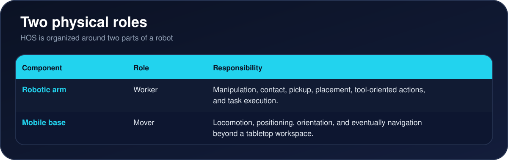
</p>


---

## Recent Updates

<p align="center">
  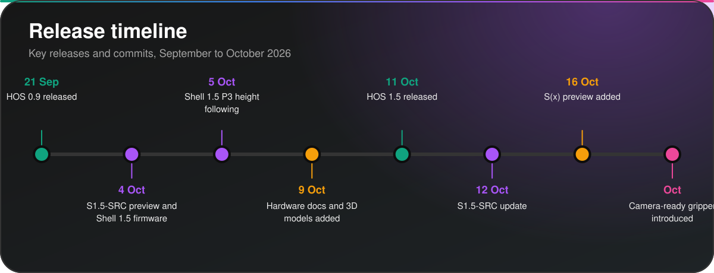
</p>


### 14 November 2026: Shell x firmware (TMC2209 sensorless Z)

- New firmware [Shell_x.ino](https://github.com/Aarav-111/Humanoid-Operating-System/blob/main/Hardware/Firmware/Shell_x/Shell_x.ino) for the Arduino Uno and CNC Shield V3. The time-of-flight (VL53L0X) and IR sensors are removed. The Z axis now uses an MKS TMC2209 V2.0 driver with StallGuard4 sensorless contact detection.
- New Z commands: ZG (pickup descent until contact), ZP (press until a load threshold, then lift 0.5 mm), ZR (return exactly to the start height) and tuning commands. All Shell 1.5 X, Y, gripper and joystick behaviour is unchanged.
- Tested in a host simulation: 26 of 26 tests pass ([test harness](https://github.com/Aarav-111/Humanoid-Operating-System/tree/main/Hardware/Firmware/Shell_x/test)). It has **not** been tested on real hardware yet. See [Shell x: TMC2209 sensorless Z](#shell-x-tmc2209-sensorless-z) below.
- New browser preview of the gantry: [HOS_3D_preview.html](https://github.com/Aarav-111/Humanoid-Operating-System/blob/main/Simulation/Virtual/HOS_3D_preview.html) (download and open it in a browser).

### 3 November 2026: Older virtual simulators removed

- The older virtual simulators K1, K1.5, K3D and K3.5D were deleted from [Simulation/Virtual](https://github.com/Aarav-111/Humanoid-Operating-System/tree/main/Simulation/Virtual) ([0e825e8](https://github.com/Aarav-111/Humanoid-Operating-System/commit/0e825e81a40217844285f642ec5bccf98ddf373c), [f96869a](https://github.com/Aarav-111/Humanoid-Operating-System/commit/f96869a9f59e49e5d86af3a564d95bdcfd7e0780), [fa6abf8](https://github.com/Aarav-111/Humanoid-Operating-System/commit/fa6abf85b023be13a58f0d302d099c21500e7ba3), [b84508a](https://github.com/Aarav-111/Humanoid-Operating-System/commit/b84508ad4c1f65311c3ca24bf77a9a1b6d810d8f)).
- The folder now holds K5D (the MMRO benchmark version) and K9D. The older files are still in the commit history.

### 3 November 2026: HOS newsletter

- A new HOS newsletter shares feature updates: what is new, what changed and what is coming next.
- Coming next, as listed in the first issue: the camera-ready gripper, **Back EMF positioning** (a new positioning method that uses back EMF readings, aimed at 15 times fewer errors in physical accuracy), and the physical robots HO-S-1 and HOS1.1.

### 25 October 2026: Hardware documentation v2.5 (Revision v4)

- New hardware guide: [HOS-Documentation-v2.5.pdf](https://github.com/Aarav-111/Humanoid-Operating-System/blob/main/Hardware/HOS-Documentation-v2.5.pdf) ([cf793e0](https://github.com/Aarav-111/Humanoid-Operating-System/commit/cf793e0dee092022a57b317fc203857f439dfc31)). It replaces the "updated v2" PDF, which was removed ([b89db36](https://github.com/Aarav-111/Humanoid-Operating-System/commit/b89db368e76bd83d162600d1aa5628314f03a0dc)).
- It is written for OSHWA open source hardware certification (CC BY-SA 4.0 docs, CERN-OHL-S-2.0 hardware).
- New sections 16 to 22: laptop and system overview, a complete bill of materials (laptop included), wiring for the Shell_1.5 firmware, step-by-step assembly, software setup, first power-on test and troubleshooting, and extra safety notes.
- A laptop is required for autonomous tasks. S1.5-SRC runs on an Apple Mac with macOS (Apple Silicon recommended). Windows and Linux are not supported in this version. The joystick can still jog the arm without the laptop.
- Values not yet confirmed by the builders are marked "TODO: confirm" in the PDF.

### 25 October 2026: Hardware docs cleanup

- The older hardware PDF (HOS-Trigonometry-1.5-Hardware-Documentation.pdf) was removed ([cfeff2c](https://github.com/Aarav-111/Humanoid-Operating-System/commit/cfeff2c8f5a3eaaa2eb5e74815dc2e996cb8c893)).
- The "updated v2" hardware guide became the current guide for a short time. It was later replaced by v2.5 (see above).

### 19 October 2026: S(x)-Src-Preview-3 (HOS X)

- The S(x) preview file is now [S(x)-Src-Preview-3.py](https://github.com/Aarav-111/Humanoid-Operating-System/blob/main/Software/S(x)-Src-Preview-3.py). It was renamed from S(x)-Src-Preview.py through Preview-1 and Preview-2 ([9ca4149](https://github.com/Aarav-111/Humanoid-Operating-System/commit/9ca4149), [bf82d60](https://github.com/Aarav-111/Humanoid-Operating-System/commit/bf82d60), [384c4e0](https://github.com/Aarav-111/Humanoid-Operating-System/commit/384c4e0)).
- New in the app: a micro trigonometry correction panel, a support camera view, a time-of-flight (ToF) sensor monitor and pickup check, a grip reachability check, a magnifier, a light and dark theme toggle, and chat prompts for missing task details.
- It is a preview build and the code changes often. Install the packages it imports before you run it.

### 18 October 2026: Funding links

- The repository now has a [FUNDING.yml](https://github.com/Aarav-111/Humanoid-Operating-System/blob/main/.github/FUNDING.yml) file, so GitHub shows a Sponsor button. Supported platforms: GitHub Sponsors (Aarav-111) and Patreon (ProlabsRobotics) ([186e5bd](https://github.com/Aarav-111/Humanoid-Operating-System/commit/186e5bd1fa658e99c8ce71e88ca4ca94ae9d79b6)).

### 17 October 2026: License update

- The [LICENSE](https://github.com/Aarav-111/Humanoid-Operating-System/blob/main/LICENSE) file is now the standard MIT License. The non-commercial clause was removed ([3f5f257](https://github.com/Aarav-111/Humanoid-Operating-System/commit/3f5f257783e1aae8fdec38a778f892bcabffdb67)).

### 17 October 2026: HOS X

HOS X is about bringing the robot into real-world applications.

Product Hunt: [HOS on Product Hunt](https://www.producthunt.com/products/humanoid-operating-system)

### 12 October 2026: S1.5-SRC update

- A new **Re-execute** button in the main window runs the current plan again from the top. If a run is in progress, it stops and restarts. It stays greyed out until a plan is ready.
- The Re-execute button takes the place of the old Vision AI Sequence button. The Vision AI Sequence still runs after an operator NO on a pickup.
- When the AprilTag comes back into view on the way back, the gantry now moves up (uq) for one more second before labelling.
- Commit: [3a3e359](https://github.com/Aarav-111/Humanoid-Operating-System/commit/3a3e359)

Full commit history is on the [commits page](https://github.com/Aarav-111/Humanoid-Operating-System/commits/main).

---

## System Architecture

<p align="center">
  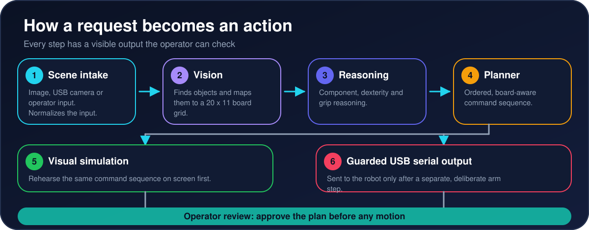
</p>


<p align="center">
  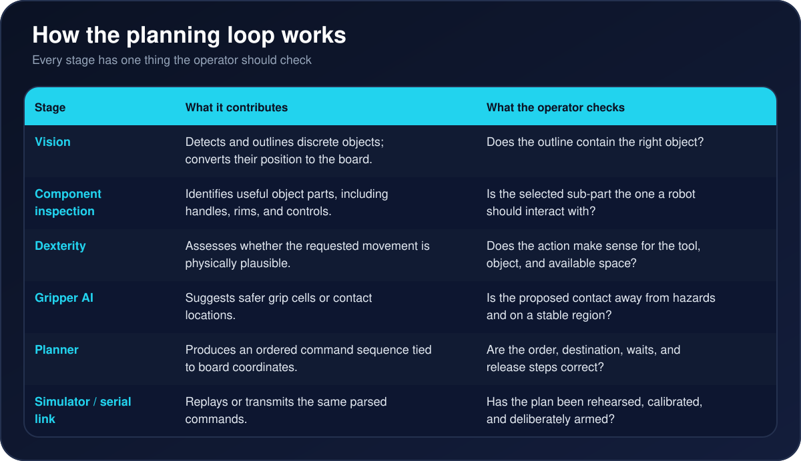
</p>


<p align="center">
  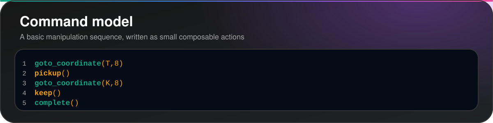
</p>


<p align="center">
  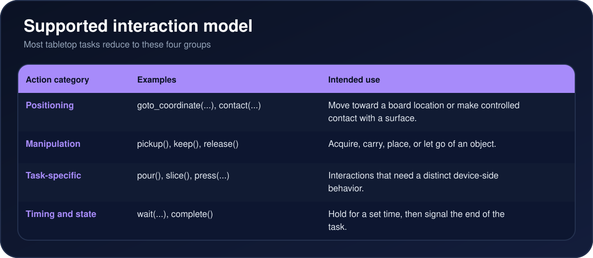
</p>


---

## Navigate This Repository

<table align="center">
  <tr>
    <td align="center" width="33%"><a href="https://github.com/Aarav-111/Humanoid-Operating-System/tree/main/Software">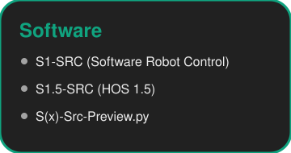</a></td>
    <td align="center" width="33%"><a href="https://github.com/Aarav-111/Humanoid-Operating-System/tree/main/Hardware">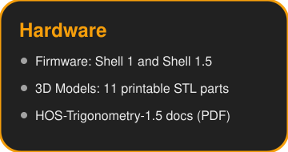</a></td>
    <td align="center" width="33%"><a href="https://github.com/Aarav-111/Humanoid-Operating-System/tree/main/Simulation">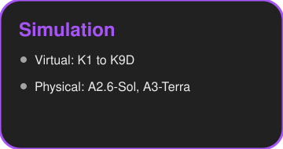</a></td>
  </tr>
  <tr>
    <td align="center" width="33%"><a href="https://github.com/Aarav-111/Humanoid-Operating-System/tree/main/Benchmarks">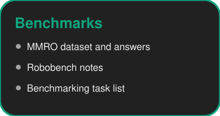</a></td>
    <td align="center" width="33%"><a href="https://github.com/Aarav-111/Humanoid-Operating-System/tree/main/assets">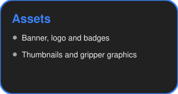</a></td>
    <td align="center" width="33%"><a href="https://github.com/Aarav-111/Humanoid-Operating-System/blob/main/LICENSE"></a></td>
  </tr>
</table>


| Folder | What you will find | Open |
| --- | --- | --- |
| README.md | Purpose, architecture, roadmap, history, benchmarks, team | [View](https://github.com/Aarav-111/Humanoid-Operating-System/blob/main/README.md) |
| Software | S1-SRC, S1.5-SRC and the S(x) preview (HOS X, Preview-3) | [Open folder](https://github.com/Aarav-111/Humanoid-Operating-System/tree/main/Software) |
| Hardware | Firmware, hardware docs and 3D models | [Open folder](https://github.com/Aarav-111/Humanoid-Operating-System/tree/main/Hardware) |
| Simulation/Virtual | K5D and K9D virtual simulators | [Open folder](https://github.com/Aarav-111/Humanoid-Operating-System/tree/main/Simulation/Virtual) |
| Simulation/Physical | A2.6-Sol and A3-Terra | [Open folder](https://github.com/Aarav-111/Humanoid-Operating-System/tree/main/Simulation/Physical) |
| Benchmarks | MMRO dataset, Robobench and task list | [Open folder](https://github.com/Aarav-111/Humanoid-Operating-System/tree/main/Benchmarks) |


### File index

Click any file to open it on GitHub.

| Folder | Files |
| --- | --- |
| Software | [S1-SRC.py](https://github.com/Aarav-111/Humanoid-Operating-System/blob/main/Software/S1-SRC.py) [S1.5-SRC.py](https://github.com/Aarav-111/Humanoid-Operating-System/blob/main/Software/S1.5-SRC.py) [S(x)-Src-Preview-3.py](https://github.com/Aarav-111/Humanoid-Operating-System/blob/main/Software/S(x)-Src-Preview-3.py) |
| Hardware/Firmware | [Shell_1.ino](https://github.com/Aarav-111/Humanoid-Operating-System/blob/main/Hardware/Firmware/Shell_1.ino) [Shell_1.5.ino](https://github.com/Aarav-111/Humanoid-Operating-System/blob/main/Hardware/Firmware/Shell_1.5.ino) [Shell_x.ino](https://github.com/Aarav-111/Humanoid-Operating-System/blob/main/Hardware/Firmware/Shell_x/Shell_x.ino) [Shell x tests](https://github.com/Aarav-111/Humanoid-Operating-System/tree/main/Hardware/Firmware/Shell_x/test) |
| Hardware (docs) | [HOS Documentation v2.5, Revision v4 (PDF)](https://github.com/Aarav-111/Humanoid-Operating-System/blob/main/Hardware/HOS-Documentation-v2.5.pdf) |
| Hardware/3D Models | [apriltag-connector](https://github.com/Aarav-111/Humanoid-Operating-System/blob/main/Hardware/3D%20Models/apriltag-connector.stl) [basic-robot](https://github.com/Aarav-111/Humanoid-Operating-System/blob/main/Hardware/3D%20Models/basic-robot.stl) [gripper-part-1](https://github.com/Aarav-111/Humanoid-Operating-System/blob/main/Hardware/3D%20Models/gripper-part-1.stl) [gripper-part-2-sponge](https://github.com/Aarav-111/Humanoid-Operating-System/blob/main/Hardware/3D%20Models/gripper-part-2-sponge.stl) [hub](https://github.com/Aarav-111/Humanoid-Operating-System/blob/main/Hardware/3D%20Models/hub.stl) [l-bracket](https://github.com/Aarav-111/Humanoid-Operating-System/blob/main/Hardware/3D%20Models/l-bracket.stl) [legs](https://github.com/Aarav-111/Humanoid-Operating-System/blob/main/Hardware/3D%20Models/legs.stl) [pulley-mount](https://github.com/Aarav-111/Humanoid-Operating-System/blob/main/Hardware/3D%20Models/pulley-mount.stl) [xy-interaxis-connector](https://github.com/Aarav-111/Humanoid-Operating-System/blob/main/Hardware/3D%20Models/xy-interaxis-connector.stl) [y-axis-holder](https://github.com/Aarav-111/Humanoid-Operating-System/blob/main/Hardware/3D%20Models/y-axis-holder.stl) [z-axis-mounter](https://github.com/Aarav-111/Humanoid-Operating-System/blob/main/Hardware/3D%20Models/z-axis-mounter.stl) |
| Simulation/Virtual | [K5D](https://github.com/Aarav-111/Humanoid-Operating-System/blob/main/Simulation/Virtual/K5D.py) [K9D](https://github.com/Aarav-111/Humanoid-Operating-System/blob/main/Simulation/Virtual/K9D.py) [HOS_3D_preview.html](https://github.com/Aarav-111/Humanoid-Operating-System/blob/main/Simulation/Virtual/HOS_3D_preview.html) |
| Simulation/Physical | [A2.6-Sol.py](https://github.com/Aarav-111/Humanoid-Operating-System/blob/main/Simulation/Physical/A2.6-Sol.py) [A3-Terra.py](https://github.com/Aarav-111/Humanoid-Operating-System/blob/main/Simulation/Physical/A3-Terra.py) |
| Benchmarks | [MMRO_Questions.json](https://github.com/Aarav-111/Humanoid-Operating-System/blob/main/Benchmarks/MMRO/Dataset/MMRO_Questions.json) [K5D_Answers.json](https://github.com/Aarav-111/Humanoid-Operating-System/blob/main/Benchmarks/MMRO/Dataset/K5D_Answers.json) [Why Choose the MMRO Benchmark](https://github.com/Aarav-111/Humanoid-Operating-System/blob/main/Benchmarks/MMRO/Why%20Choose%20the%20MMRO%20Benchmark.md) [Robobench_benchmark.md](https://github.com/Aarav-111/Humanoid-Operating-System/blob/main/Benchmarks/Robobench/Robobench_benchmark.md) [Benchmarking-tasks.md](https://github.com/Aarav-111/Humanoid-Operating-System/blob/main/Benchmarks/Benchmarking-tasks.md) |
| Root | [LICENSE](https://github.com/Aarav-111/Humanoid-Operating-System/blob/main/LICENSE) [README.md](https://github.com/Aarav-111/Humanoid-Operating-System/blob/main/README.md) |

Quick links: [Software](https://github.com/Aarav-111/Humanoid-Operating-System/tree/main/Software) | [Hardware](https://github.com/Aarav-111/Humanoid-Operating-System/tree/main/Hardware) | [Firmware](https://github.com/Aarav-111/Humanoid-Operating-System/tree/main/Hardware/Firmware) | [3D Models](https://github.com/Aarav-111/Humanoid-Operating-System/tree/main/Hardware/3D%20Models) | [Simulation/Virtual](https://github.com/Aarav-111/Humanoid-Operating-System/tree/main/Simulation/Virtual) | [Simulation/Physical](https://github.com/Aarav-111/Humanoid-Operating-System/tree/main/Simulation/Physical) | [Benchmarks](https://github.com/Aarav-111/Humanoid-Operating-System/tree/main/Benchmarks)

1. [Read the README](https://github.com/Aarav-111/Humanoid-Operating-System/blob/main/README.md)
2. [Simulation/Virtual](https://github.com/Aarav-111/Humanoid-Operating-System/tree/main/Simulation/Virtual): see how planning evolved
3. [Simulation/Physical](https://github.com/Aarav-111/Humanoid-Operating-System/tree/main/Simulation/Physical): trace intake to serial output
4. [Hardware](https://github.com/Aarav-111/Humanoid-Operating-System/tree/main/Hardware): check firmware and setup before connecting
5. [Benchmarks](https://github.com/Aarav-111/Humanoid-Operating-System/tree/main/Benchmarks): reproduce evaluations


---

## Run It From the Terminal

You need Git and Python 3. Hardware steps need the Arduino IDE or `arduino-cli`.

### Clone the whole repository

```bash
git clone https://github.com/Aarav-111/Humanoid-Operating-System.git
cd Humanoid-Operating-System
```

### Download a single file

Use the raw link. Replace the path with the file you want.

```bash
curl -L -O https://raw.githubusercontent.com/Aarav-111/Humanoid-Operating-System/main/Software/S1.5-SRC.py
```

Or with `wget`:

```bash
wget https://raw.githubusercontent.com/Aarav-111/Humanoid-Operating-System/main/Software/S1.5-SRC.py
```

### Download one folder only

```bash
git clone --depth 1 --filter=blob:none --sparse https://github.com/Aarav-111/Humanoid-Operating-System.git
cd Humanoid-Operating-System
git sparse-checkout set Hardware/3D%20Models
```

### Run the Python software

S1.5-SRC needs an Apple Mac running macOS (Apple Silicon recommended). Windows and Linux are not supported in this version. See section 16 of the [hardware documentation v2.5](https://github.com/Aarav-111/Humanoid-Operating-System/blob/main/Hardware/HOS-Documentation-v2.5.pdf) for the full list.

Install the packages imported at the top of the file you run, then start it:

```bash
python3 -m venv .venv
source .venv/bin/activate
pip install openai opencv-python numpy pyserial
export OPENAI_API_KEY="your-key-here"
python3 Software/S1.5-SRC.py
```

The AI stages need your own OpenAI key. Never commit it to the repository.

### Flash the firmware

Open `Hardware/Firmware/Shell_1.5.ino` in the Arduino IDE, select your board and port, then upload. Use `Shell_1.ino` for the older Shell 1 build.

For Shell x (TMC2209 on Z), install the **TMCStepper** library first, then upload `Hardware/Firmware/Shell_x/Shell_x.ino`. With `arduino-cli`:

```bash
arduino-cli core install arduino:avr
arduino-cli lib install TMCStepper
arduino-cli compile --fqbn arduino:avr:uno Hardware/Firmware/Shell_x
arduino-cli upload -p /dev/cu.usbmodemXXXX --fqbn arduino:avr:uno Hardware/Firmware/Shell_x
```

Wire the driver as shown in [Shell x wiring](#wiring-and-pin-map) before you power on.

### Get the 3D parts

Download the STL files from [Hardware/3D Models](https://github.com/Aarav-111/Humanoid-Operating-System/tree/main/Hardware/3D%20Models), or use the sparse-checkout command above.

---

## Simulator History

<p align="center">
  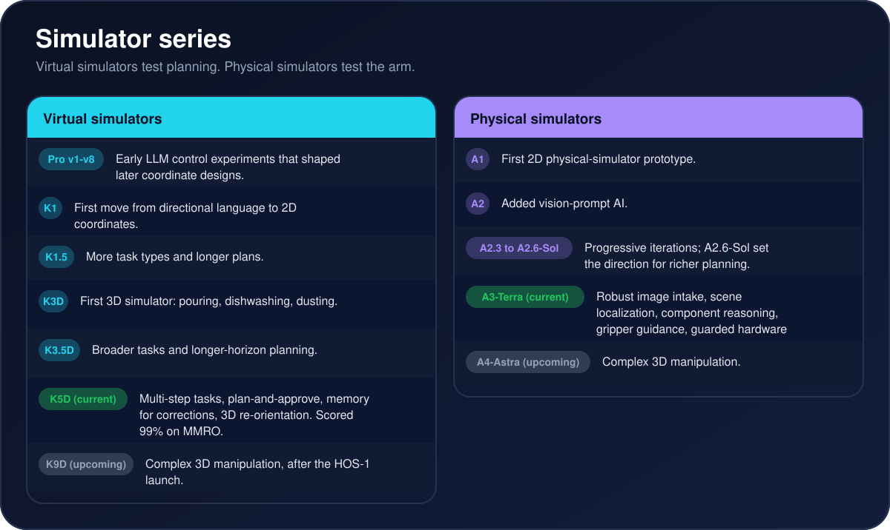
</p>


---

## Roadmap for 2026

<p align="center">
  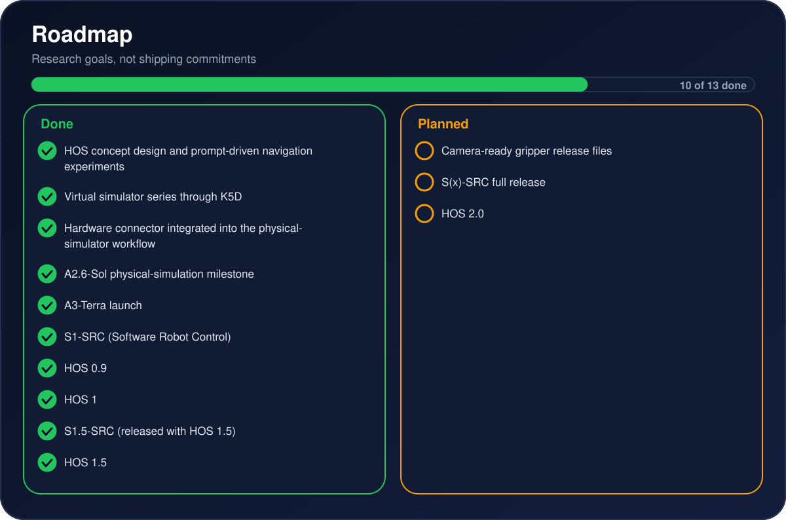
</p>


<p align="center">
  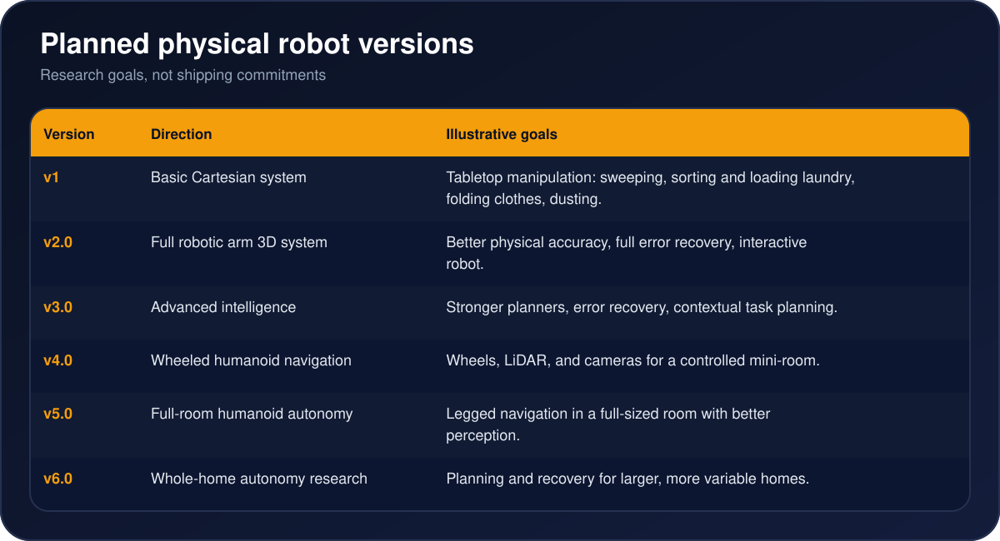
</p>


---

## Benchmarking

<p align="center">
  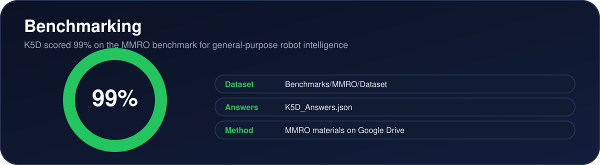
</p>


---

## Running Cost

<p align="center">
  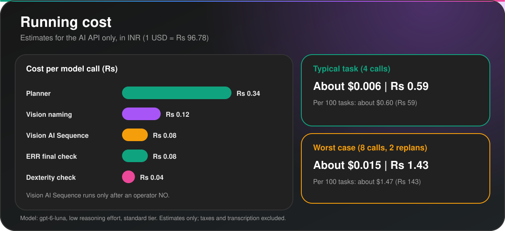
</p>


All numbers below are **estimates**, not measured bills. They cover the AI API only.

| Item | Model calls | USD (est.) | INR (est.) |
| --- | --- | --- | --- |
| Planner call | 1 | $0.0035 | Rs 0.34 |
| Vision naming call (2 photos) | 1 | $0.0013 | Rs 0.12 |
| ERR final check call (1 photo) | 1 | $0.0009 | Rs 0.08 |
| Vision AI Sequence call (only after an operator NO) | 1 | $0.0009 | Rs 0.08 |
| Dexterity check call | 1 | $0.0005 | Rs 0.04 |
| Typical task, no failures | 4 | about $0.006 | about Rs 0.59 |
| Typical, per 100 tasks | 400 | about $0.60 | about Rs 59 |
| Worst case task, 2 replans | 8 | about $0.015 | about Rs 1.43 |
| Worst case, per 100 tasks | 800 | about $1.47 | about Rs 143 |

**What HOS calls:** OpenAI API with your own key. Model `gpt-6-luna` for planning, vision naming, dexterity, ERR and Vision AI Sequence, at `low` reasoning effort, standard tier. Replanning is limited to 2 automatic attempts. Optional voice input uses `gpt-4o-transcribe` (fallback `whisper-1`) and is not included.

**Price used:** `gpt-6-luna` standard tier, $0.10 per 1M input tokens and $0.50 per 1M output tokens. Source: [OpenAI API pricing](https://developers.openai.com/api/docs/pricing), checked 1 November 2026 (no change since 11 October 2026). Exchange rate: 1 USD = Rs 96.78 (10 October 2026).

**Assumptions:** about 20,000 input and 3,000 output tokens for the planner, 5,000 in and 1,500 out for vision naming, 3,500 in and 1,000 out for ERR and Vision AI Sequence, 2,000 in and 500 out for dexterity. Photo token counts are rough guesses. No prompt caching. Output includes reasoning tokens. Taxes and transcription not included. Check the `[timing]` lines S1.5-SRC prints for real token counts.

**Hardware:** the [hardware docs v2.5](https://github.com/Aarav-111/Humanoid-Operating-System/blob/main/Hardware/HOS-Documentation-v2.5.pdf) list parts but no prices, so no hardware cost is given. Main parts: an Apple Mac laptop (required to run S1.5-SRC), overhead USB webcam, Arduino Uno and CNC Shield V3 with A4988 drivers, NEMA 17 steppers, 12 V 10 A power supply, 2020 V-slot frame, GT2 belts and pulleys, T8 lead screw, 8 mm rods, time-of-flight and IR sensors (Shell 1.5; Shell x replaces both with a TMC2209 driver on Z), AprilTag 36h11 and 3D-printed parts.

Source: [Software/S1.5-SRC.py](https://github.com/Aarav-111/Humanoid-Operating-System/blob/main/Software/S1.5-SRC.py), first worked out at commit [7fe076e](https://github.com/Aarav-111/Humanoid-Operating-System/commit/7fe076e6622cab2954850d361ee9b7810eea0f29) and rechecked at [3a3e359](https://github.com/Aarav-111/Humanoid-Operating-System/commit/3a3e359) (no change to models or call count).

---

## Hardware

<p align="center">
  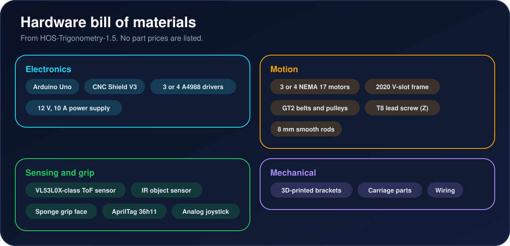
</p>

### Hardware overview

| Part | What it is |
| --- | --- |
| Frame | Cartesian gantry on 2020 V-slot. X and Y on GT2 belts, Z on a T8 lead screw (8 mm lead, 400 steps per mm at 1/16) |
| Controller | Arduino Uno with CNC Shield V3, USB serial to the laptop at 115200 baud |
| Drivers | A4988 on X, Y and A (gripper). MKS TMC2209 V2.0 on Z for Shell x |
| Motors | NEMA 17 steppers |
| Power | 12 V 10 A supply |
| Gripper | Horizontal NEMA 17 tool motor with a sponge gripper (G0 to G90) |
| Work area | 20 x 20 grid, columns A to T and rows 1 to 20 |
| Vision | Overhead USB webcam and AprilTag 36h11 (used by the laptop software) |
| Manual control | Joystick: VRX jogs Z, VRY jogs the gripper, SW for creep and double-tap stop |

Full build guide, bill of materials and assembly steps: [HOS-Documentation-v2.5.pdf](https://github.com/Aarav-111/Humanoid-Operating-System/blob/main/Hardware/HOS-Documentation-v2.5.pdf). That PDF describes Shell 1.5 with ToF and IR. The Shell x changes below are not in the PDF yet.

### Shell x: TMC2209 sensorless Z

<p align="center">
  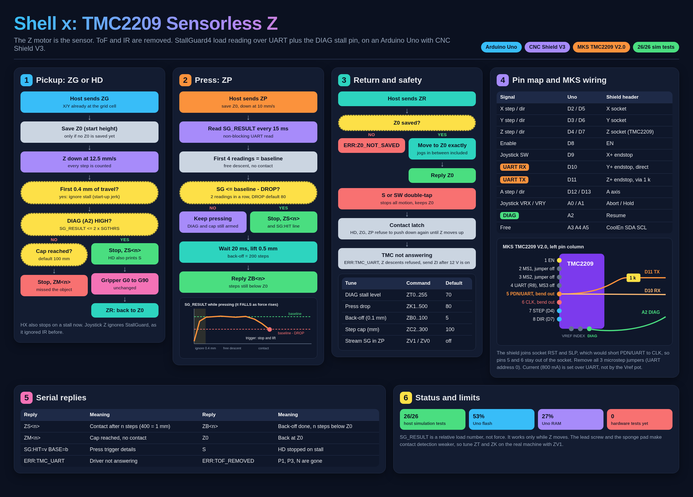
</p>

**What is new in Shell x**

- The VL53L0X time-of-flight sensor, the IR sensor, the P1/P3 height-follow and the E distance readout are removed.
- The Z motor itself is the sensor. The TMC2209 measures motor load (StallGuard4) and reports it over a one-wire UART, and its DIAG pin goes HIGH on a stall.
- HD now goes down until it touches something, then stops and prints `S` (same as the old IR stop) and `ZS<n>`.
- New ZG, ZP and ZR commands for pickup, press and an exact return.
- Everything else is the same as Shell 1.5: X and Y moves, Q slow variants, HU, HX, G0 to G90, S stop, the SW double-tap stop, joystick jog and SW creep, and the `hx` message.

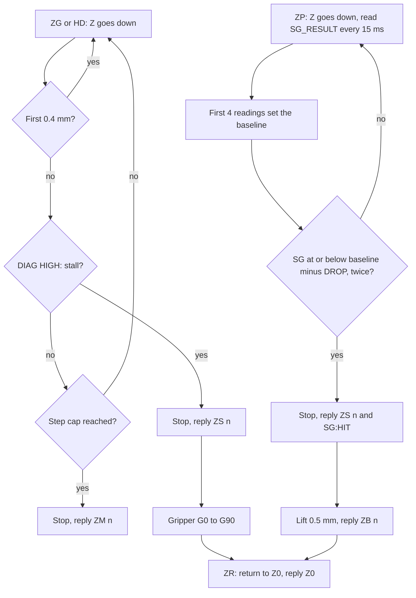

#### Wiring and pin map

| Signal | Uno pin | CNC Shield header | Note |
| --- | --- | --- | --- |
| X step / dir | D2 / D5 | X socket | unchanged |
| Y step / dir | D3 / D6 | Y socket | unchanged |
| Z step / dir | D4 / D7 | Z socket | now the TMC2209 |
| Enable (all drivers) | D8 | EN | unchanged |
| Joystick SW | D9 | X+ endstop | unchanged |
| TMC UART RX | D10 | Y+ endstop | wire straight to PDN/UART |
| TMC UART TX | D11 | Z+ endstop | through a 1 kOhm resistor to PDN/UART (D11 was the IR input) |
| A step / dir | D12 / D13 | A axis | unchanged |
| Joystick VRX / VRY | A0 / A1 | Abort / Hold | unchanged |
| TMC DIAG | A2 | Resume | from the DIAG front pin |
| Free now | A3, A4, A5 | CoolEn, SDA, SCL | I2C is no longer used |

**MKS TMC2209 V2.0 notes**

1. The left pin column from EN is: EN, MS1, MS2, UART (R8), PDN/UART, CLK, STEP, DIR. The extra front pins are VREF, INDEX and DIAG.
2. The CNC Shield joins socket RST and SLP (pins 5 and 6). That would short PDN/UART to CLK, so bend pins 5 and 6 out of the socket and take the UART wire from pin 5 with a Dupont lead.
3. Remove all three microstep jumpers under the Z socket. MS1 and MS2 low sets UART address 0, and the MS3 jumper must not pull pin 4 to 5 V.
4. Motor current (800 mA) is set over UART, not by the Vref pot.
5. The driver logic runs from the 12 V motor supply. If 12 V was off when the Uno started, send `ZI` after turning it on.

#### Serial commands

Unchanged from Shell 1.5:

| Command | Action |
| --- | --- |
| U / D / L / R | Move Y up, Y down, X left, X right |
| UQ / DQ / LQ / RQ | Same moves at one third speed |
| S | Stop all movement (always wins, at any time) |
| G0 to G90 | Gripper angle |
| HU | Z up (cancels HX) |
| HX | Z down until S, a double-tap, or (new) a stall |

Changed or new in Shell x:

| Command | Action | Reply |
| --- | --- | --- |
| HD | Z down until stall or the step cap | `S` and `ZS<n>`, or `ZM<n>` |
| ZG | Pickup: save Z0, go down until stall | `ZG:DOWN`, then `ZS<n>` or `ZM<n>` |
| ZP | Press: go down until the load threshold, then lift | `ZP:DOWN`, `ZS<n>`, `SG:HIT=v BASE=b BY=SG or DIAG`, `ZB<n>` |
| ZR | Return exactly to Z0 | `Z0`, or `ERR:Z0_NOT_SAVED` |
| ZT0 to ZT255 | Set SGTHRS (DIAG stall level), default 70 | `CFG:SGTHRS=n` |
| ZK1 to ZK500 | Set the press drop, default 80 | `CFG:PRESS_DROP=n` |
| ZB0 to ZB100 | Set the back-off in 0.1 mm, default 5 (0.5 mm) | `CFG:BACKOFF_STEPS=n` |
| ZC2 to ZC300 | Set the step cap in mm, default 100 | `CFG:CAP_MM=n` |
| ZV1 / ZV0 | Stream SG readings during ZP | `CFG:SG_STREAM=n`, then `SG:v` lines |
| ZI | Re-start the TMC2209 over UART | `TMC:OK` or `ERR:TMC_UART` |
| E | StallGuard status (was ToF distance) | `SG:RESULT=.. SGTHRS=.. DIAG=.. UART_ERR=..` |
| I | DIAG status (was IR) | `DIAG:STALL` or `DIAG:CLEAR` |
| J | SW, HX and Z state | `LIMIT:..`, `HX:..`, `Z:mode POS= Z0= LATCH= TMC=` |
| P, N | Removed (ToF) | `ERR:TOF_REMOVED` |

`n` in `ZS`, `ZM` and `ZB` is a step count (400 steps = 1 mm). `ZB<n>` is how many steps the tool is still below Z0.

#### How the press works

The TMC2209 does not give a force value. It gives `SG_RESULT`, a number from 0 to 510 that **falls** as the motor load rises. It only means something while the motor is moving at a steady speed.

1. ZP moves Z down at about 10 mm/s and reads `SG_RESULT` every 15 ms without stopping the motor.
2. The first 0.4 mm is ignored, because the motor jerks when it starts.
3. The next 4 readings are averaged into a baseline (free movement, no contact).
4. When two readings in a row are at least DROP below the baseline, the tool is pressing. Z stops and lifts 0.5 mm.
5. The DIAG pin (hard stall) and the step cap stay active the whole time as backups.

#### Tuning steps

1. Power on with 12 V and check that the Uno prints `TMC:OK`. Send `E` and check that `UART_ERR` stays at 0.
2. Jog Z clear of everything. Send `ZV1` then `ZP` and watch the free-moving `SG:` values.
3. Set `ZT` to about 0.35 to 0.45 of that free value (DIAG fires at or below 2 x SGTHRS). Test `ZG` over a hard surface. If it stops in mid-air, lower `ZT`. If it grinds, raise `ZT`.
4. Press the real object with `ZV1` on and set `ZK` to about half the drop you see. Smaller means a lighter press.
5. Keep the back-off (`ZB`) longer than 0.4 mm, so a second press starts sensing before it reaches the object. The firmware warns if it is not.
6. Set `ZC` a little below your real Z travel.

#### Test results (simulation only)

<p align="center">
  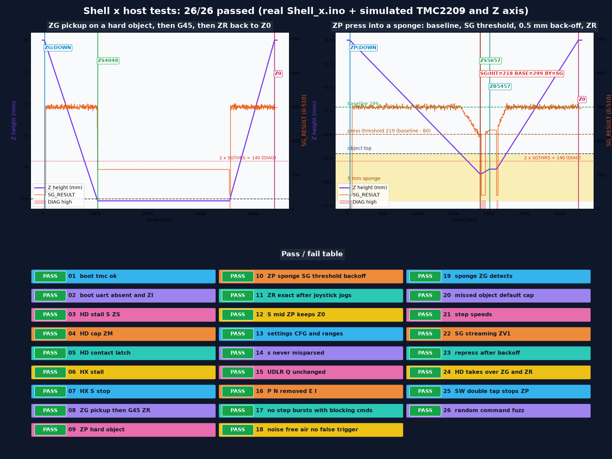
</p>

The real `Shell_x.ino` was compiled on a computer with a mock Arduino core, a simulated TMC2209 (UART registers with CRC, DIAG) and a simulated Z axis (hard object, sponge, noise, start-up jerk). **26 of 26 tests pass.** Details, the log and the 5 test iterations are in [Hardware/Firmware/Shell_x/test](https://github.com/Aarav-111/Humanoid-Operating-System/tree/main/Hardware/Firmware/Shell_x/test).

| Checked | Result in simulation |
| --- | --- |
| HD stall on a hard object | `S` and `ZS8048`, 0.12 mm into the object, 0 lost steps |
| Missed object | stops at the cap with `ZM` |
| ZP into a sponge | triggers on SG (`SG:HIT=218 BASE=299`), backs off exactly 200 steps |
| ZR after joystick jogs | returns to the exact start step |
| Noise in free air | no false contact |
| S at any time | stops within 0.3 ms |
| X, Y, gripper, joystick | same behaviour as Shell 1.5 |
| Uno memory | 17,308 bytes flash (53%), 566 bytes RAM (27%) |

Firmware bugs found by the tests and fixed: the press could push into the object again after a back-off (stall ignore distance shortened from 1 mm to 0.4 mm), a stop inside a setting printed an error, and a UART interrupt could make one Z step 22% short.

#### Limits

- Not tested on the real machine yet. The thresholds are starting points.
- `SG_RESULT` is a relative load number, not force in newtons. It needs calibration on each machine.
- StallGuard works only while Z moves. There is no pressure sensing when Z stands still.
- The lead screw hides load from the motor, and the sponge pad softens contact, so detection can be late. In simulation, ZG stopped about 3.9 mm into a 5 mm sponge.
- Manual joystick Z ignores StallGuard (like it ignored IR in Shell 1.5) and can push into an object.
- Real Z speeds are lower than requested because of loop time: about 12 mm/s for HD, 10 mm/s for ZG and 8 mm/s for ZP in simulation.


---

## Safety and Responsible Use

<p align="center">
  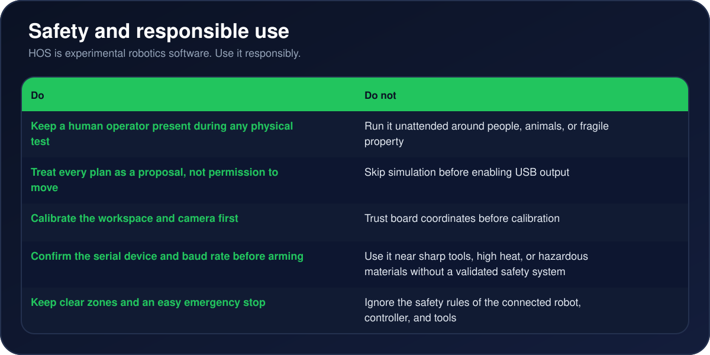
</p>


---

## Team and Contact

| Role | Name |
|---|---|
| Project Lead | Aarav Jaisingh |
| Project Co-lead | Siyona Chicker |
| Project Manager | Mathew Jose Tony |
| Collaborators | Job San Jose, Sai Sachin, Atharva Roongta, Aarush Wagh |


<p align="center">
  <a href="https://HOS.prolabsrobotics.chatgpt.site"></a>
  <a href="mailto:prolabsrobotics@gmail.com"></a>
  <a href="https://www.youtube.com/watch?v=wpmh6HE-oz8"></a>
</p>

For collaboration, research, or project questions: **prolabsrobotics@gmail.com**

---

<p align="center">
  <b>Humanoid Operating System</b><br>
  Building an inspectable path from scene understanding to supervised robot action.
</p>

---

## Links

| Link | Where |
|---|---|
| Product Hunt | [Humanoid Operating System](https://www.producthunt.com/products/humanoid-operating-system) |
| Virtual License | [Virtual License](#) |
