<p align="center">
  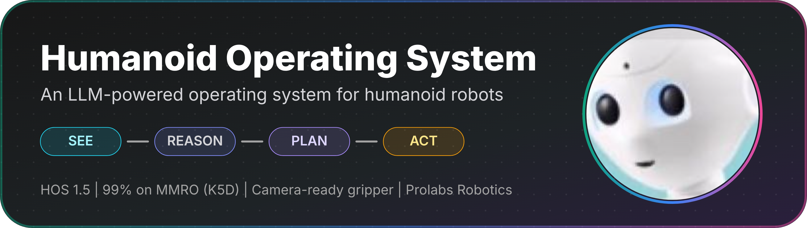
</p>

<p align="center">
  <a href="https://github.com/Aarav-111/Humanoid-Operating-System#recent-updates"></a>
  <a href="https://github.com/Aarav-111/Humanoid-Operating-System#benchmarking"></a>
  <a href="https://github.com/Aarav-111/Humanoid-Operating-System#camera-ready-gripper"></a>
  <a href="https://github.com/Aarav-111/Humanoid-Operating-System/tree/main/Software"></a>
  <a href="https://github.com/Aarav-111/Humanoid-Operating-System/tree/main/Hardware/Firmware"></a>
  <a href="https://github.com/Aarav-111/Humanoid-Operating-System/blob/main/LICENSE"></a>
</p>

<p align="center">
  <b>Demo Videos</b> &nbsp;|&nbsp; <b>Camera-Ready Gripper</b> &nbsp;|&nbsp; <b>Architecture</b> &nbsp;|&nbsp; <b>Navigate</b> &nbsp;|&nbsp; <b>Roadmap</b> &nbsp;|&nbsp; <b>Running Cost</b> &nbsp;|&nbsp; <b>Run It</b> &nbsp;|&nbsp; <b>Team</b>
</p>

---

## Overview

> An LLM-powered control layer and modular operating system for humanoid robots.

Jensen Huang has spoken about the need for a general-purpose robot breakthrough before humanoids can scale. HOS is our attempt at that: a foundational software and hardware framework that gives humanoid robots a generalized, reasoning-driven "mind."

Instead of training isolated models per task (the approach used by most VLA models, including Gemini Robotics and pi0.5), HOS uses an LLM-driven control layer for multi-modal decision-making. This repository covers the full HOS system: the mobile base for locomotion and the robotic arm for manipulation.

<p align="center">
  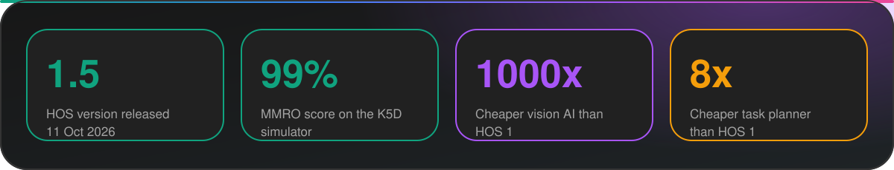
</p>


**Status:** HOS 1.5 released (11 October 2026). Active research and prototyping continue. Built by Prolabs Robotics, Bengaluru, India.

---

## Demo Videos

<table align="center">
  <tr>
    <td align="center" width="50%">
      <a href="https://www.youtube.com/watch?v=wpmh6HE-oz8">
        
      </a>
      <br><b>HOS 1.5 task compilation</b><br>11 October 2026
    </td>
    <td align="center" width="50%">
      <a href="https://youtu.be/9Af5JZoZxco">
        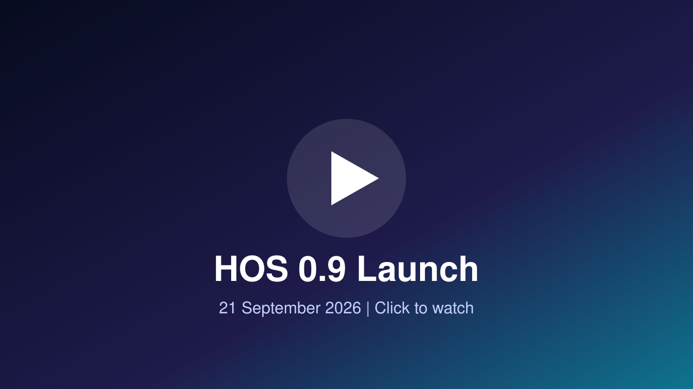
      </a>
      <br><b>HOS 0.9 launch</b><br>21 September 2026
    </td>
  </tr>
</table>

---

## Camera-Ready Gripper

We are introducing the **camera-ready gripper**, a super precise gripper built for **automatic pickup**.

<p align="center">
  
</p>

<p align="center">
  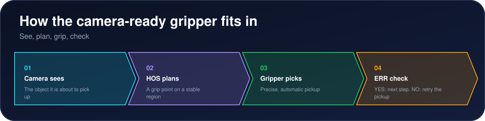
</p>


Full specs, STL files, and setup notes will be added to the [Hardware](https://github.com/Aarav-111/Humanoid-Operating-System/tree/main/Hardware) folder.

---

## Why HOS

Robots in homes and workspaces need more than a fixed sequence of moves. They need to read a changing scene, reason about the outcome, decide whether a move is feasible, and show that decision to an operator before motion starts. HOS connects perception, planning, simulation, and hardware control, with clear review points at each step.

<p align="center">
  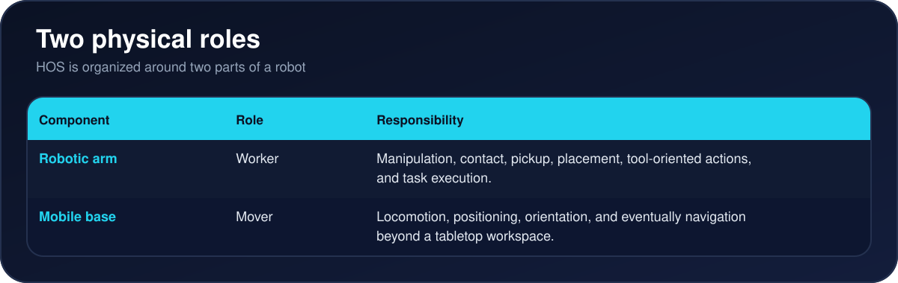
</p>


---

## Recent Updates

<p align="center">
  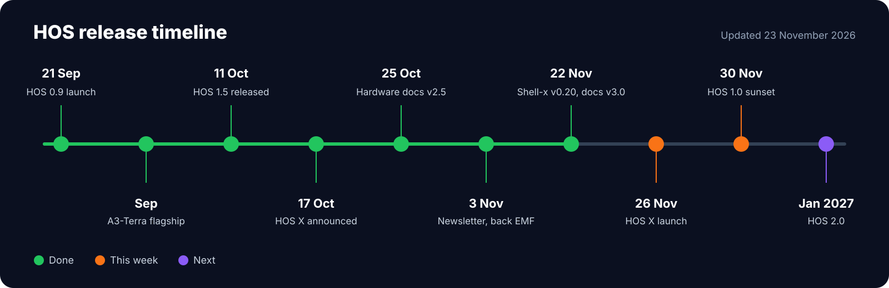
</p>


### 22 November 2026: Hardware and electronics guide for Shell-x v0.20

- The [Hardware](#hardware) section now describes Shell-x v0.20: X, Y and Z on A4988 drivers, and a potentiometer on A0 read as a binary LIFTED or DOWN sensor for Z.
- HD now stops Z at the DOWN position. P1, P3, the gripper, the joystick and the TMC2209 sensorless Z are not used.
- New pin map, pot wiring, command table, speeds, first power-on test and limits.
- New hardware documentation PDF [HOS-Documentation-v3.0.pdf](https://github.com/Aarav-111/Humanoid-Operating-System/blob/main/Hardware/HOS-Documentation-v3.0.pdf) for Shell-x v0.20. It replaces v2.5 and covers the A4988 wiring with a diagram, the sliding potentiometer, a new bill of materials, the v0.20 commands, speeds, first power-on test, troubleshooting and limits. The old v2.5 PDF was removed.
- The Shell-x v0.20 firmware is now in the repository as [Shell_x.ino](https://github.com/Aarav-111/Humanoid-Operating-System/blob/main/Hardware/Firmware/Shell_x/Shell_x.ino). It compiles for the Arduino Uno with no extra libraries.

### 14 November 2026: The Giga Hardware Upgrade (Shell x)

**The giga hardware upgrade:** Shell x firmware with a TMC2209 sensorless Z axis.

- New firmware [Shell_x.ino](https://github.com/Aarav-111/Humanoid-Operating-System/blob/main/Hardware/Firmware/Shell_x/Shell_x.ino) for the Arduino Uno and CNC Shield V3. The time-of-flight (VL53L0X) and IR sensors are removed. The Z axis now uses an MKS TMC2209 V2.0 driver with StallGuard4 sensorless contact detection.
- New Z commands: ZG (pickup descent until contact), ZP (press until a load threshold, then lift 0.5 mm), ZR (return exactly to the start height) and tuning commands. All Shell 1.5 X, Y, gripper and joystick behaviour is unchanged.
- Tested in a host simulation: 26 of 26 tests pass ([test harness](https://github.com/Aarav-111/Humanoid-Operating-System/tree/main/Hardware/Firmware/Shell_x/test)). It has **not** been tested on real hardware yet. This design was later dropped. See [Hardware](#hardware) for the current Shell-x v0.20.
- New browser preview of the gantry: [HOS_3D_preview.html](https://github.com/Aarav-111/Humanoid-Operating-System/blob/main/Simulation/Virtual/HOS_3D_preview.html) (download and open it in a browser).

### 3 November 2026: Older virtual simulators removed

- The older virtual simulators K1, K1.5, K3D and K3.5D were deleted from [Simulation/Virtual](https://github.com/Aarav-111/Humanoid-Operating-System/tree/main/Simulation/Virtual) ([0e825e8](https://github.com/Aarav-111/Humanoid-Operating-System/commit/0e825e81a40217844285f642ec5bccf98ddf373c), [f96869a](https://github.com/Aarav-111/Humanoid-Operating-System/commit/f96869a9f59e49e5d86af3a564d95bdcfd7e0780), [fa6abf8](https://github.com/Aarav-111/Humanoid-Operating-System/commit/fa6abf85b023be13a58f0d302d099c21500e7ba3), [b84508a](https://github.com/Aarav-111/Humanoid-Operating-System/commit/b84508ad4c1f65311c3ca24bf77a9a1b6d810d8f)).
- The folder now holds K5D (the MMRO benchmark version) and K9D. The older files are still in the commit history.

### 3 November 2026: HOS newsletter

- A new HOS newsletter shares feature updates: what is new, what changed and what is coming next.
- Coming next, as listed in the first issue: the camera-ready gripper, **Back EMF positioning** (a new positioning method that uses back EMF readings, aimed at 15 times fewer errors in physical accuracy), and the physical robots HO-S-1 and HOS1.1.

### 25 October 2026: Hardware documentation v2.5 (Revision v4)

- New hardware guide: HOS-Documentation-v2.5.pdf (v2.5, now replaced by [v3.0](https://github.com/Aarav-111/Humanoid-Operating-System/blob/main/Hardware/HOS-Documentation-v3.0.pdf)) ([cf793e0](https://github.com/Aarav-111/Humanoid-Operating-System/commit/cf793e0dee092022a57b317fc203857f439dfc31)). It replaces the "updated v2" PDF, which was removed ([b89db36](https://github.com/Aarav-111/Humanoid-Operating-System/commit/b89db368e76bd83d162600d1aa5628314f03a0dc)).
- It is written for OSHWA open source hardware certification (CC BY-SA 4.0 docs, CERN-OHL-S-2.0 hardware).
- New sections 16 to 22: laptop and system overview, a complete bill of materials (laptop included), wiring for the Shell_1.5 firmware, step-by-step assembly, software setup, first power-on test and troubleshooting, and extra safety notes.
- A laptop is required for autonomous tasks. S1.5-SRC runs on an Apple Mac with macOS (Apple Silicon recommended). Windows and Linux are not supported in this version. The joystick can still jog the arm without the laptop.

### 25 October 2026: Hardware docs cleanup

- The older hardware PDF (HOS-Trigonometry-1.5-Hardware-Documentation.pdf) was removed ([cfeff2c](https://github.com/Aarav-111/Humanoid-Operating-System/commit/cfeff2c8f5a3eaaa2eb5e74815dc2e996cb8c893)).
- The "updated v2" hardware guide became the current guide for a short time. It was later replaced by v2.5 (see above).

### 19 October 2026: S(x)-Src-Preview-3 (HOS X)

- The S(x) preview file is now [S(x)-Src-Preview-3.py](https://github.com/Aarav-111/Humanoid-Operating-System/blob/main/Software/S(x)-Src-Preview-3.py). It was renamed from S(x)-Src-Preview.py through Preview-1 and Preview-2 ([9ca4149](https://github.com/Aarav-111/Humanoid-Operating-System/commit/9ca4149), [bf82d60](https://github.com/Aarav-111/Humanoid-Operating-System/commit/bf82d60), [384c4e0](https://github.com/Aarav-111/Humanoid-Operating-System/commit/384c4e0)).
- New in the app: a micro trigonometry correction panel, a support camera view, a time-of-flight (ToF) sensor monitor and pickup check, a grip reachability check, a magnifier, a light and dark theme toggle, and chat prompts for missing task details.
- It is a preview build and the code changes often. Install the packages it imports before you run it.

### 18 October 2026: Funding links

- The repository now has a [FUNDING.yml](https://github.com/Aarav-111/Humanoid-Operating-System/blob/main/.github/FUNDING.yml) file, so GitHub shows a Sponsor button. Supported platforms: GitHub Sponsors (Aarav-111) and Patreon (ProlabsRobotics) ([186e5bd](https://github.com/Aarav-111/Humanoid-Operating-System/commit/186e5bd1fa658e99c8ce71e88ca4ca94ae9d79b6)).

### 17 October 2026: License update

- The [LICENSE](https://github.com/Aarav-111/Humanoid-Operating-System/blob/main/LICENSE) file is now the standard MIT License. The non-commercial clause was removed ([3f5f257](https://github.com/Aarav-111/Humanoid-Operating-System/commit/3f5f257783e1aae8fdec38a778f892bcabffdb67)).

### 17 October 2026: HOS X

HOS X is about bringing the robot into real-world applications.

Product Hunt: [HOS on Product Hunt](https://www.producthunt.com/products/humanoid-operating-system)

### 12 October 2026: S1.5-SRC update

- A new **Re-execute** button in the main window runs the current plan again from the top. If a run is in progress, it stops and restarts. It stays greyed out until a plan is ready.
- The Re-execute button takes the place of the old Vision AI Sequence button. The Vision AI Sequence still runs after an operator NO on a pickup.
- When the AprilTag comes back into view on the way back, the gantry now moves up (uq) for one more second before labelling.
- Commit: [3a3e359](https://github.com/Aarav-111/Humanoid-Operating-System/commit/3a3e359)

Full commit history is on the [commits page](https://github.com/Aarav-111/Humanoid-Operating-System/commits/main).

---

## System Architecture

<p align="center">
  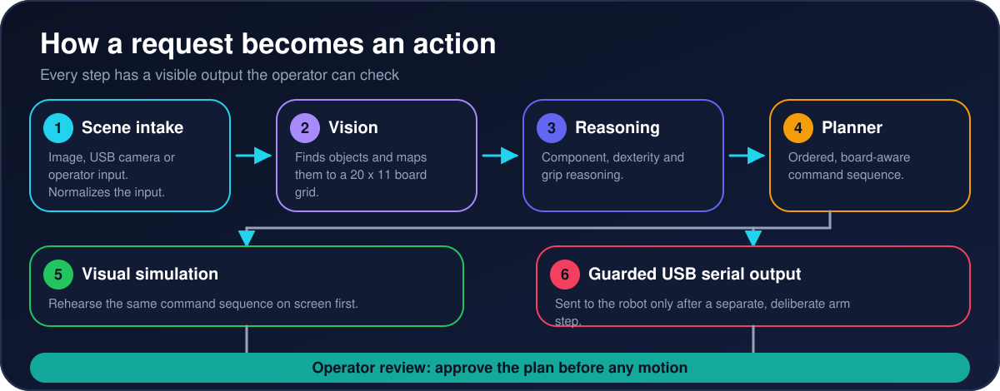
</p>


<p align="center">
  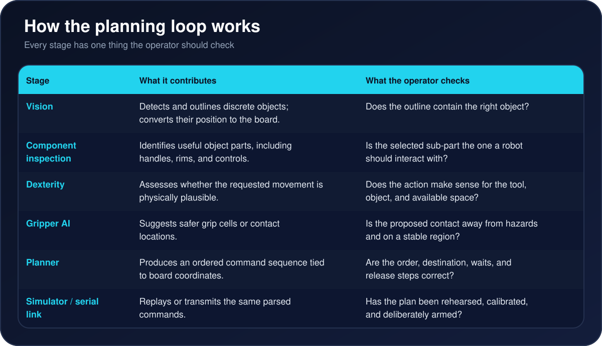
</p>


<p align="center">
  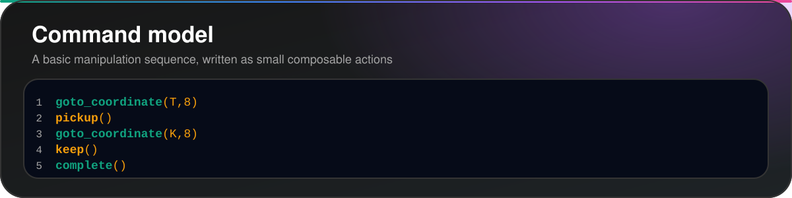
</p>


<p align="center">
  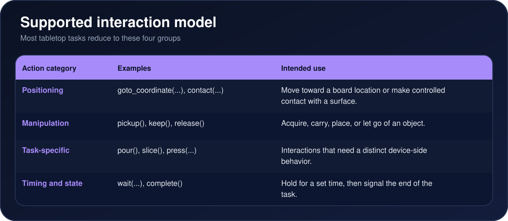
</p>


---

## Navigate This Repository

<table align="center">
  <tr>
    <td align="center" width="33%"><a href="https://github.com/Aarav-111/Humanoid-Operating-System/tree/main/Software">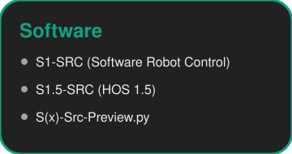</a></td>
    <td align="center" width="33%"><a href="https://github.com/Aarav-111/Humanoid-Operating-System/tree/main/Hardware">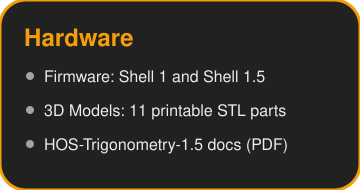</a></td>
    <td align="center" width="33%"><a href="https://github.com/Aarav-111/Humanoid-Operating-System/tree/main/Simulation">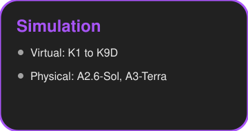</a></td>
  </tr>
  <tr>
    <td align="center" width="33%"><a href="https://github.com/Aarav-111/Humanoid-Operating-System/tree/main/Benchmarks">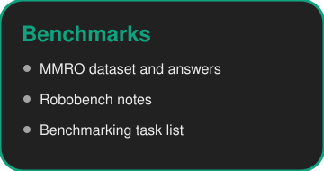</a></td>
    <td align="center" width="33%"><a href="https://github.com/Aarav-111/Humanoid-Operating-System/tree/main/assets">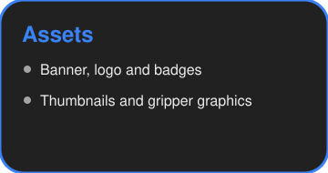</a></td>
    <td align="center" width="33%"><a href="https://github.com/Aarav-111/Humanoid-Operating-System/blob/main/LICENSE"></a></td>
  </tr>
</table>


| Folder | What you will find | Open |
| --- | --- | --- |
| README.md | Purpose, architecture, roadmap, history, benchmarks, team | [View](https://github.com/Aarav-111/Humanoid-Operating-System/blob/main/README.md) |
| Software | S1-SRC, S1.5-SRC and the S(x) preview (HOS X, Preview-3) | [Open folder](https://github.com/Aarav-111/Humanoid-Operating-System/tree/main/Software) |
| Hardware | Firmware, hardware docs and 3D models | [Open folder](https://github.com/Aarav-111/Humanoid-Operating-System/tree/main/Hardware) |
| Simulation/Virtual | K5D and K9D virtual simulators | [Open folder](https://github.com/Aarav-111/Humanoid-Operating-System/tree/main/Simulation/Virtual) |
| Simulation/Physical | A2.6-Sol and A3-Terra | [Open folder](https://github.com/Aarav-111/Humanoid-Operating-System/tree/main/Simulation/Physical) |
| Benchmarks | MMRO dataset, Robobench and task list | [Open folder](https://github.com/Aarav-111/Humanoid-Operating-System/tree/main/Benchmarks) |


### File index

Click any file to open it on GitHub.

| Folder | Files |
| --- | --- |
| Software | [S1-SRC.py](https://github.com/Aarav-111/Humanoid-Operating-System/blob/main/Software/S1-SRC.py) [S1.5-SRC.py](https://github.com/Aarav-111/Humanoid-Operating-System/blob/main/Software/S1.5-SRC.py) [S(x)-Src-Preview-3.py](https://github.com/Aarav-111/Humanoid-Operating-System/blob/main/Software/S(x)-Src-Preview-3.py) |
| Hardware/Firmware | [Shell_1.ino](https://github.com/Aarav-111/Humanoid-Operating-System/blob/main/Hardware/Firmware/Shell_1.ino) [Shell_1.5.ino](https://github.com/Aarav-111/Humanoid-Operating-System/blob/main/Hardware/Firmware/Shell_1.5.ino) [Shell_x.ino](https://github.com/Aarav-111/Humanoid-Operating-System/blob/main/Hardware/Firmware/Shell_x/Shell_x.ino) [Shell x tests (old TMC2209 build)](https://github.com/Aarav-111/Humanoid-Operating-System/tree/main/Hardware/Firmware/Shell_x/test) |
| Hardware (docs) | [HOS Documentation v3.0, Shell-x v0.20 (PDF)](https://github.com/Aarav-111/Humanoid-Operating-System/blob/main/Hardware/HOS-Documentation-v3.0.pdf) |
| Hardware/3D Models | [apriltag-connector](https://github.com/Aarav-111/Humanoid-Operating-System/blob/main/Hardware/3D%20Models/apriltag-connector.stl) [basic-robot](https://github.com/Aarav-111/Humanoid-Operating-System/blob/main/Hardware/3D%20Models/basic-robot.stl) [gripper-part-1](https://github.com/Aarav-111/Humanoid-Operating-System/blob/main/Hardware/3D%20Models/gripper-part-1.stl) [gripper-part-2-sponge](https://github.com/Aarav-111/Humanoid-Operating-System/blob/main/Hardware/3D%20Models/gripper-part-2-sponge.stl) [hub](https://github.com/Aarav-111/Humanoid-Operating-System/blob/main/Hardware/3D%20Models/hub.stl) [l-bracket](https://github.com/Aarav-111/Humanoid-Operating-System/blob/main/Hardware/3D%20Models/l-bracket.stl) [legs](https://github.com/Aarav-111/Humanoid-Operating-System/blob/main/Hardware/3D%20Models/legs.stl) [pulley-mount](https://github.com/Aarav-111/Humanoid-Operating-System/blob/main/Hardware/3D%20Models/pulley-mount.stl) [xy-interaxis-connector](https://github.com/Aarav-111/Humanoid-Operating-System/blob/main/Hardware/3D%20Models/xy-interaxis-connector.stl) [y-axis-holder](https://github.com/Aarav-111/Humanoid-Operating-System/blob/main/Hardware/3D%20Models/y-axis-holder.stl) [z-axis-mounter](https://github.com/Aarav-111/Humanoid-Operating-System/blob/main/Hardware/3D%20Models/z-axis-mounter.stl) |
| Simulation/Virtual | [K5D](https://github.com/Aarav-111/Humanoid-Operating-System/blob/main/Simulation/Virtual/K5D.py) [K9D](https://github.com/Aarav-111/Humanoid-Operating-System/blob/main/Simulation/Virtual/K9D.py) [HOS_3D_preview.html](https://github.com/Aarav-111/Humanoid-Operating-System/blob/main/Simulation/Virtual/HOS_3D_preview.html) |
| Simulation/Physical | [A2.6-Sol.py](https://github.com/Aarav-111/Humanoid-Operating-System/blob/main/Simulation/Physical/A2.6-Sol.py) [A3-Terra.py](https://github.com/Aarav-111/Humanoid-Operating-System/blob/main/Simulation/Physical/A3-Terra.py) |
| Benchmarks | [MMRO_Questions.json](https://github.com/Aarav-111/Humanoid-Operating-System/blob/main/Benchmarks/MMRO/Dataset/MMRO_Questions.json) [K5D_Answers.json](https://github.com/Aarav-111/Humanoid-Operating-System/blob/main/Benchmarks/MMRO/Dataset/K5D_Answers.json) [Why Choose the MMRO Benchmark](https://github.com/Aarav-111/Humanoid-Operating-System/blob/main/Benchmarks/MMRO/Why%20Choose%20the%20MMRO%20Benchmark.md) [Robobench_benchmark.md](https://github.com/Aarav-111/Humanoid-Operating-System/blob/main/Benchmarks/Robobench/Robobench_benchmark.md) [Benchmarking-tasks.md](https://github.com/Aarav-111/Humanoid-Operating-System/blob/main/Benchmarks/Benchmarking-tasks.md) |
| Root | [LICENSE](https://github.com/Aarav-111/Humanoid-Operating-System/blob/main/LICENSE) [README.md](https://github.com/Aarav-111/Humanoid-Operating-System/blob/main/README.md) |

Quick links: [Software](https://github.com/Aarav-111/Humanoid-Operating-System/tree/main/Software) | [Hardware](https://github.com/Aarav-111/Humanoid-Operating-System/tree/main/Hardware) | [Firmware](https://github.com/Aarav-111/Humanoid-Operating-System/tree/main/Hardware/Firmware) | [3D Models](https://github.com/Aarav-111/Humanoid-Operating-System/tree/main/Hardware/3D%20Models) | [Simulation/Virtual](https://github.com/Aarav-111/Humanoid-Operating-System/tree/main/Simulation/Virtual) | [Simulation/Physical](https://github.com/Aarav-111/Humanoid-Operating-System/tree/main/Simulation/Physical) | [Benchmarks](https://github.com/Aarav-111/Humanoid-Operating-System/tree/main/Benchmarks)

1. [Read the README](https://github.com/Aarav-111/Humanoid-Operating-System/blob/main/README.md)
2. [Simulation/Virtual](https://github.com/Aarav-111/Humanoid-Operating-System/tree/main/Simulation/Virtual): see how planning evolved
3. [Simulation/Physical](https://github.com/Aarav-111/Humanoid-Operating-System/tree/main/Simulation/Physical): trace intake to serial output
4. [Hardware](https://github.com/Aarav-111/Humanoid-Operating-System/tree/main/Hardware): check firmware and setup before connecting
5. [Benchmarks](https://github.com/Aarav-111/Humanoid-Operating-System/tree/main/Benchmarks): reproduce evaluations


---

## Run It From the Terminal

You need Git and Python 3. Hardware steps need the Arduino IDE or `arduino-cli`.

### Clone the whole repository

```bash
git clone https://github.com/Aarav-111/Humanoid-Operating-System.git
cd Humanoid-Operating-System
```

### Download a single file

Use the raw link. Replace the path with the file you want.

```bash
curl -L -O https://raw.githubusercontent.com/Aarav-111/Humanoid-Operating-System/main/Software/S1.5-SRC.py
```

Or with `wget`:

```bash
wget https://raw.githubusercontent.com/Aarav-111/Humanoid-Operating-System/main/Software/S1.5-SRC.py
```

### Download one folder only

```bash
git clone --depth 1 --filter=blob:none --sparse https://github.com/Aarav-111/Humanoid-Operating-System.git
cd Humanoid-Operating-System
git sparse-checkout set Hardware/3D%20Models
```

### Run the Python software

S1.5-SRC needs an Apple Mac running macOS (Apple Silicon recommended). Windows and Linux are not supported in this version. See section 16 of the [hardware documentation v3.0](https://github.com/Aarav-111/Humanoid-Operating-System/blob/main/Hardware/HOS-Documentation-v3.0.pdf) for the full list.

Install the packages imported at the top of the file you run, then start it:

```bash
python3 -m venv .venv
source .venv/bin/activate
pip install openai opencv-python numpy pyserial
export OPENAI_API_KEY="your-key-here"
python3 Software/S1.5-SRC.py
```

The AI stages need your own OpenAI key. Never commit it to the repository.

### Flash the firmware

Open `Hardware/Firmware/Shell_1.5.ino` in the Arduino IDE, select your board and port, then upload. Use `Shell_1.ino` for the older Shell 1 build.

For Shell-x v0.20, open `Hardware/Firmware/Shell_x/Shell_x.ino` and upload it to the Uno. It needs no extra libraries. Set the Serial Monitor to 115200 baud and Newline, then type `HELP`.

Wire it as shown in [Electronics: Shell-x v0.20](#electronics-shell-x-v020) before you power on.

### Get the 3D parts

Download the STL files from [Hardware/3D Models](https://github.com/Aarav-111/Humanoid-Operating-System/tree/main/Hardware/3D%20Models), or use the sparse-checkout command above.

---

## Simulator History

<p align="center">
  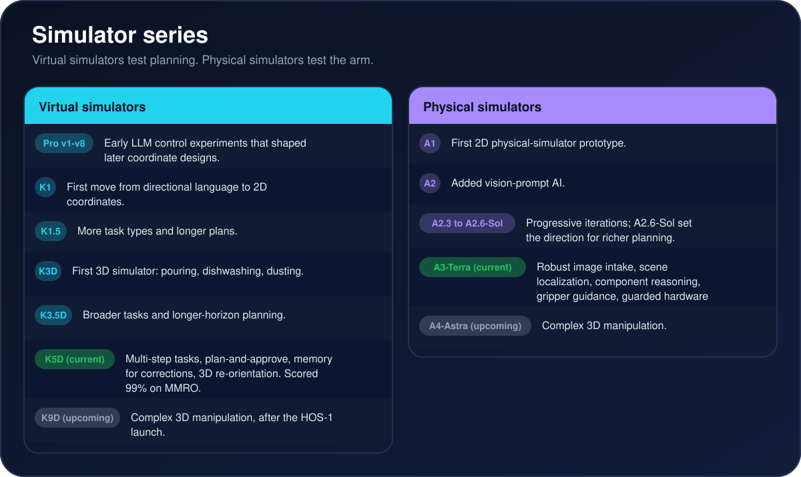
</p>


---

## Roadmap for 2026

<p align="center">
  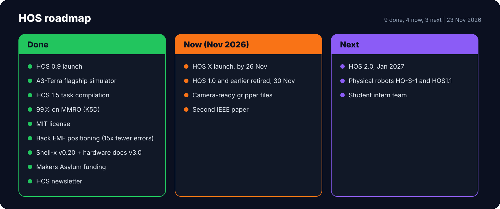
</p>


<p align="center">
  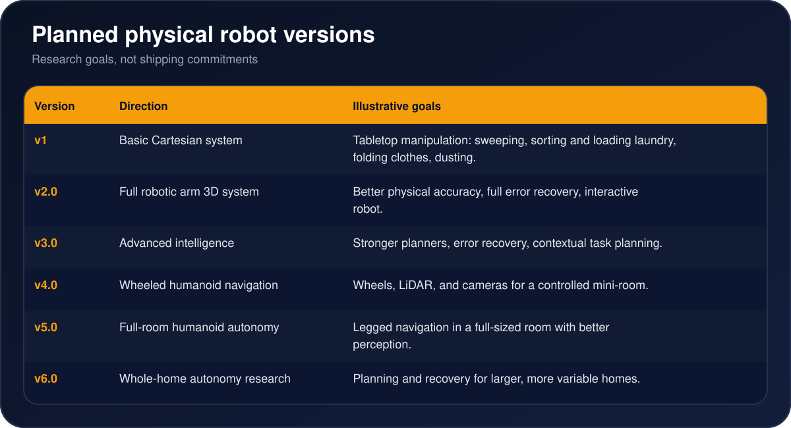
</p>


---

## Benchmarking

<p align="center">
  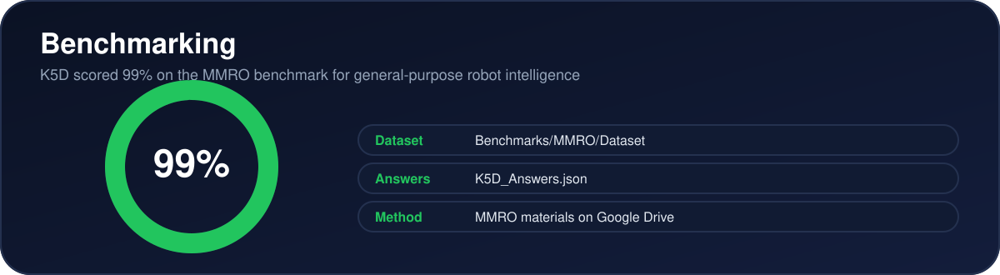
</p>


---

## Running Cost

<p align="center">
  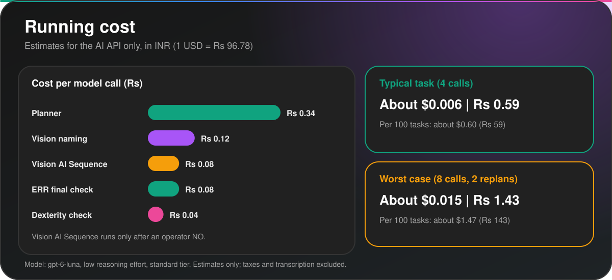
</p>


All numbers below are **estimates**, not measured bills. They cover the AI API only.

| Item | Model calls | USD (est.) | INR (est.) |
| --- | --- | --- | --- |
| Planner call | 1 | $0.0035 | Rs 0.34 |
| Vision naming call (2 photos) | 1 | $0.0013 | Rs 0.12 |
| ERR final check call (1 photo) | 1 | $0.0009 | Rs 0.08 |
| Vision AI Sequence call (only after an operator NO) | 1 | $0.0009 | Rs 0.08 |
| Dexterity check call | 1 | $0.0005 | Rs 0.04 |
| Typical task, no failures | 4 | about $0.006 | about Rs 0.59 |
| Typical, per 100 tasks | 400 | about $0.60 | about Rs 59 |
| Worst case task, 2 replans | 8 | about $0.015 | about Rs 1.43 |
| Worst case, per 100 tasks | 800 | about $1.47 | about Rs 143 |

**What HOS calls:** OpenAI API with your own key. Model `gpt-6-luna` for planning, vision naming, dexterity, ERR and Vision AI Sequence, at `low` reasoning effort, standard tier. Replanning is limited to 2 automatic attempts. Optional voice input uses `gpt-4o-transcribe` (fallback `whisper-1`) and is not included.

**Price used:** `gpt-6-luna` standard tier, $0.10 per 1M input tokens and $0.50 per 1M output tokens. Source: [OpenAI API pricing](https://developers.openai.com/api/docs/pricing), checked 1 November 2026 (no change since 11 October 2026). Exchange rate: 1 USD = Rs 96.78 (10 October 2026).

**Assumptions:** about 20,000 input and 3,000 output tokens for the planner, 5,000 in and 1,500 out for vision naming, 3,500 in and 1,000 out for ERR and Vision AI Sequence, 2,000 in and 500 out for dexterity. Photo token counts are rough guesses. No prompt caching. Output includes reasoning tokens. Taxes and transcription not included. Check the `[timing]` lines S1.5-SRC prints for real token counts.

**Hardware:** the [hardware docs v3.0](https://github.com/Aarav-111/Humanoid-Operating-System/blob/main/Hardware/HOS-Documentation-v3.0.pdf) list parts but no prices, so no hardware cost is given. Main parts: an Apple Mac laptop (required to run S1.5-SRC), overhead USB webcam, Arduino Uno and CNC Shield V3 with A4988 drivers, NEMA 17 steppers, 12 V 10 A power supply, 2020 V-slot frame, GT2 belts and pulleys, T8 lead screw, 8 mm rods, time-of-flight and IR sensors (Shell 1.5; Shell-x v0.20 replaces both with one sliding potentiometer on Z), AprilTag 36h11 and 3D-printed parts.

Source: [Software/S1.5-SRC.py](https://github.com/Aarav-111/Humanoid-Operating-System/blob/main/Software/S1.5-SRC.py), first worked out at commit [7fe076e](https://github.com/Aarav-111/Humanoid-Operating-System/commit/7fe076e6622cab2954850d361ee9b7810eea0f29) and rechecked at [3a3e359](https://github.com/Aarav-111/Humanoid-Operating-System/commit/3a3e359) (no change to models or call count).

---

## Hardware

<p align="center">
  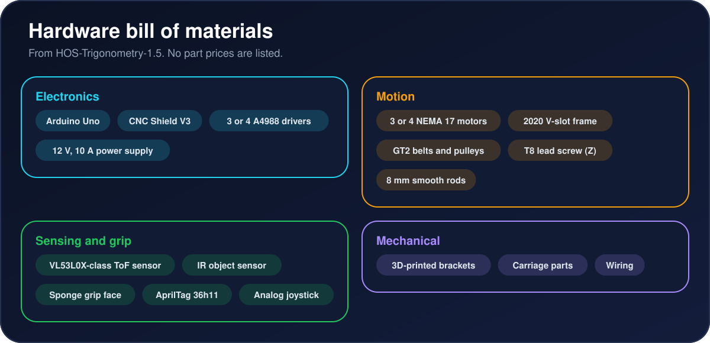
</p>

> **Current build: Shell-x v0.20.** X, Y and Z only, all on A4988 drivers. One sliding potentiometer on A0 tells the firmware if the Z tool is LIFTED or DOWN. The TMC2209 sensorless Z, the gripper (A axis), the joystick, IR and ToF sensors are not used in this version.

### Hardware overview

| Part | Shell-x v0.20 |
| --- | --- |
| Frame | Cartesian gantry on 2020 V-slot. X and Y on GT2 belts, Z on a T8 lead screw |
| Controller | Arduino Uno with CNC Shield V3, USB serial to the laptop at 115200 baud |
| Drivers | A4988 on X, Y and Z (all three) |
| Motors | NEMA 17 steppers (17HS4401) on X, Y and Z |
| Power | 12 V 10 A supply into the CNC Shield screw terminal |
| Z sensor | One sliding (linear) potentiometer read as a binary sensor: 1 = LIFTED, 0 = DOWN |
| Not used in v0.20 | A axis and gripper, joystick, IR sensor, ToF sensor, TMC2209 |
| Work area | 20 x 20 grid, columns A to T and rows 1 to 20 |
| Vision | Overhead USB webcam and AprilTag 36h11 (used by the laptop software) |

Full build guide, bill of materials, wiring diagram and assembly steps for Shell-x v0.20: [HOS-Documentation-v3.0.pdf](https://github.com/Aarav-111/Humanoid-Operating-System/blob/main/Hardware/HOS-Documentation-v3.0.pdf). The firmware is [Shell_x.ino](https://github.com/Aarav-111/Humanoid-Operating-System/blob/main/Hardware/Firmware/Shell_x/Shell_x.ino).

### Electronics: Shell-x v0.20

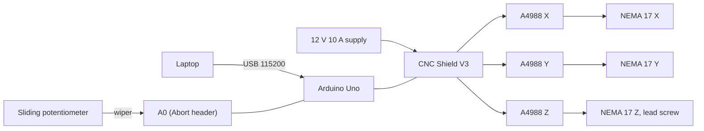

#### Pin map

| Signal | Uno pin | CNC Shield header | Note |
| --- | --- | --- | --- |
| X step / dir | D2 / D5 | X socket | A4988, direction inverted in firmware |
| Y step / dir | D3 / D6 | Y socket | A4988 |
| Z step / dir | D4 / D7 | Z socket | A4988, dir HIGH = Z up |
| Enable (all drivers) | D8 | EN | active LOW, driven LOW at start-up |
| Potentiometer wiper | A0 | Abort | binary Z sensor |
| Free | D9 to D13, A1 to A5 | endstops, A axis, Hold, Resume, CoolEn, SDA, SCL | not used by v0.20 |

#### Potentiometer wiring

| Pot terminal | Connect to |
| --- | --- |
| One outer terminal | 5 V |
| Other outer terminal | GND |
| Middle (wiper) | A0, the Abort pin on the CNC Shield |

Fix the body of the sliding pot so it does not move with Z, and link its slider to the Z tool so the slider moves with the tool. When the tool is lifted the reading must sit at the top of the range (1022 to 1023). When it reaches the down position the reading must fall to 1018 or lower. If it works the wrong way round, swap the two outer wires.

#### Driver setup (A4988)

1. Put an A4988 in the X, Y and Z sockets. The Z socket no longer holds the TMC2209, so put back the microstep jumpers under Z to match X and Y, and the shield's normal RST/SLP link is fine again.
2. Set each A4988 current with its Vref pot before connecting the motors.
3. Never plug or unplug a motor while 12 V is on. This kills drivers.
4. Plug the Uno USB in first, then turn on 12 V.

### How the binary Z sensor works

The sliding pot is still analog. The firmware turns its reading into two states.

| Reading (0 to 1023) | State |
| --- | --- |
| 1022 or higher | 1, LIFTED |
| 1019 to 1021 | deadband, keeps the last state |
| 1018 or lower | 0, DOWN |

- Each reading is the rounded average of 16 ADC samples, taken every 5 ms.
- A new state is only reported after it stays past its boundary for 100 ms.
- During `HD`, Z stops **at once** the first time the reading hits 1018 or lower. It does not wait the 100 ms, so noise can stop Z early but cannot make it travel further.
- `HD` is refused with `BLOCKED:ALREADY_AT_DOWN_POSITION` if the state is already DOWN.
- There is no automatic lift. Send `HU` to go back up.
- `THR n` moves the boundary (default 1020) and `HYST n` sets the deadband (default 2). Both are lost at power-off.

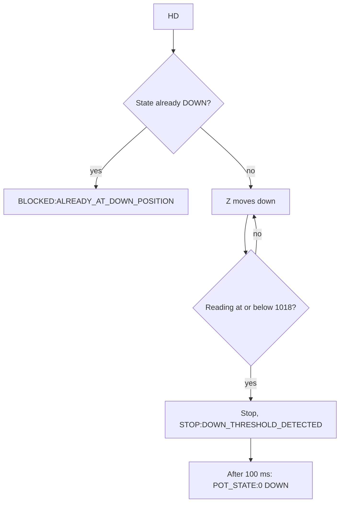

### Serial commands (v0.20)

Set the Serial Monitor to 115200 baud and line ending to Newline (or Both NL and CR). Commands are not case sensitive.

| Command | Action | Reply |
| --- | --- | --- |
| U / D | Y up / down, until S | `RUN:Y_UP` / `RUN:Y_DOWN` |
| R / L | X right / left, until S | `RUN:X_RIGHT` / `RUN:X_LEFT` |
| UQ / DQ / RQ / LQ | Same moves at one third speed | same as above |
| HU | Z up, until S | `RUN:Z_UP` |
| HD (or HX) | Z down, stops at DOWN | `RUN:Z_DOWN_SENSOR_STOP`, then `STOP:DOWN_THRESHOLD_DETECTED` |
| S (or STOP) | Stop all motion | `STOPPED` |
| READ | Pot reading and state | `POT_RAW: POT_STATE: POSITION: THR: HYST: LIFT_AT: DOWN_AT_OR_BELOW:` |
| STATUS (or V, J) | Motion and sensor status | `MOTION:X/Y/Z_UP/Z_DOWN/STOPPED` plus the READ line |
| THR 0 to 1023 | Set the boundary (RAM only) | `THR_SET:n` |
| HYST 0 to 100 | Set the deadband (RAM only) | `HYST_SET:n` |
| HELP (or ?) | List commands | command list |

Every state change also prints a line like `POT_CROSSED:BELOW | POT_STATE:0 | POSITION:DOWN | POT_RAW:1015`.

Removed since earlier Shell x builds: G0 to G90 (gripper), P1 and P3, the 1/2/3 calibration, ZG, ZP, ZR and all TMC2209 commands, E, I, and joystick jog.

### Speeds

Only one axis moves at a time. Step rates come from the firmware timing. Real mm/s depends on your microstep jumpers and pulleys.

| Move | Half period | Step rate |
| --- | --- | --- |
| X / Y normal | 2,672 us | about 187 steps/s |
| X / Y slow (Q) | 8,016 us | about 62 steps/s |
| Z (HU, HD) | 5,333 us | about 94 steps/s |

### First power-on test

1. Upload Shell-x v0.20. The Uno prints `SHELL-X v0.20 READY` and a `POT_INITIAL` line.
2. Send `READ`. With the tool lifted, `POT_STATE` must be 1 and `POT_RAW` 1022 or more.
3. Turn on 12 V. Send `R`, then `S`. Repeat for L, U and D and check each direction.
4. Send `HU`, then `S`. Check that Z goes up.
5. Send `HD` with your hand near the 12 V switch. Z must stop by itself at the down position.
6. If it stops too early or too late, use `READ` at both positions and adjust with `THR` and `HYST`.

### Limits and safety

- The pot reports position, not force. Do not use it as the only safety device.
- The boundary sits at 1020 of 1023, very close to the top of the range. A 5 V dip can read as DOWN, which only stops Z early. But if the wiper wire comes loose, A0 floats and can stay high, and then HD never stops. Keep a hand on the power switch for the first tests.
- HU has no top limit. Stop it yourself with S.
- THR and HYST reset at every power-on.
- If Z misses steps on the lead screw, the pot still tells the truth about position, but X and Y have no sensor at all.

### Earlier: Shell x with TMC2209 sensorless Z (dropped)

The 14 November build used an MKS TMC2209 V2.0 on Z with StallGuard over UART. It passed 26 of 26 tests in simulation ([test harness](https://github.com/Aarav-111/Humanoid-Operating-System/tree/main/Hardware/Firmware/Shell_x/test)), but on the real machine the UART link never worked reliably, so it was dropped for the A4988 and pot design above. Its wiring and commands are still in the commit history at [69c1562](https://github.com/Aarav-111/Humanoid-Operating-System/commit/69c1562).


---

## Safety and Responsible Use

<p align="center">
  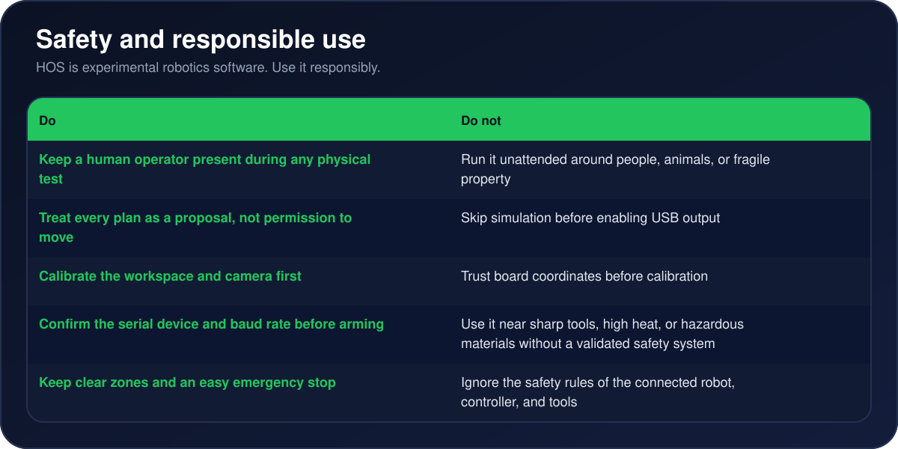
</p>


---

## Team and Contact

| Role | Name |
|---|---|
| Project Lead | Aarav Jaisingh |
| Project Co-lead | Siyona Chicker |
| Project Manager | Mathew Jose Tony |
| Collaborators | Job San Jose, Sai Sachin, Atharva Roongta, Aarush Wagh |


<p align="center">
  <a href="https://HOS.prolabsrobotics.chatgpt.site"></a>
  <a href="mailto:prolabsrobotics@gmail.com"></a>
  <a href="https://www.youtube.com/watch?v=wpmh6HE-oz8"></a>
</p>

For collaboration, research, or project questions: **prolabsrobotics@gmail.com**

---

<p align="center">
  <b>Humanoid Operating System</b><br>
  Building an inspectable path from scene understanding to supervised robot action.
</p>

---

## Links

| Link | Where |
|---|---|
| Product Hunt | [Humanoid Operating System](https://www.producthunt.com/products/humanoid-operating-system) |
| Virtual License | [Virtual License](#) |
