<p align="center">
  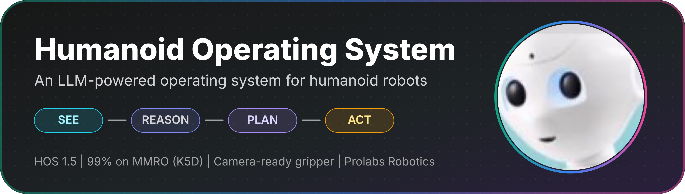
</p>

<p align="center">
  <a href="https://github.com/Aarav-111/Humanoid-Operating-System#recent-updates"></a>
  <a href="https://github.com/Aarav-111/Humanoid-Operating-System#benchmarking"></a>
  <a href="https://github.com/Aarav-111/Humanoid-Operating-System#camera-ready-gripper"></a>
  <a href="https://github.com/Aarav-111/Humanoid-Operating-System/tree/main/Software"></a>
  <a href="https://github.com/Aarav-111/Humanoid-Operating-System/tree/main/Hardware/Firmware"></a>
  <a href="https://github.com/Aarav-111/Humanoid-Operating-System/blob/main/LICENSE"></a>
</p>

<p align="center">
  <b>Demo Videos</b> &nbsp;|&nbsp; <b>Camera-Ready Gripper</b> &nbsp;|&nbsp; <b>Architecture</b> &nbsp;|&nbsp; <b>Navigate</b> &nbsp;|&nbsp; <b>Roadmap</b> &nbsp;|&nbsp; <b>Running Cost</b> &nbsp;|&nbsp; <b>Run It</b> &nbsp;|&nbsp; <b>Team</b>
</p>

---

## Overview

> An LLM-powered control layer and modular operating system for humanoid robots.

Jensen Huang has spoken about the need for a general-purpose robot breakthrough before humanoids can scale. HOS is our attempt at that: a foundational software and hardware framework that gives humanoid robots a generalized, reasoning-driven "mind."

Instead of training isolated models per task (the approach used by most VLA models, including Gemini Robotics and pi0.5), HOS uses an LLM-driven control layer for multi-modal decision-making. This repository covers the full HOS system: the mobile base for locomotion and the robotic arm for manipulation.

<p align="center">
  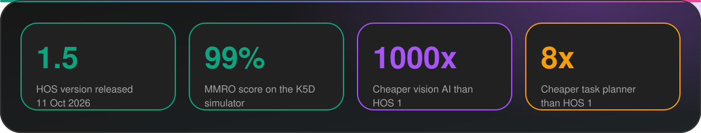
</p>


**Status:** HOS 1.5 released (11 October 2026). Active research and prototyping continue. Built by Prolabs Robotics, Bengaluru, India.

---

## Demo Videos

<table align="center">
  <tr>
    <td align="center" width="50%">
      <a href="https://www.youtube.com/watch?v=wpmh6HE-oz8">
        
      </a>
      <br><b>HOS 1.5 task compilation</b><br>11 October 2026
    </td>
    <td align="center" width="50%">
      <a href="https://youtu.be/9Af5JZoZxco">
        
      </a>
      <br><b>HOS 0.9 launch</b><br>21 September 2026
    </td>
  </tr>
</table>

---

## Camera-Ready Gripper

We are introducing the **camera-ready gripper**, a super precise gripper built for **automatic pickup**.

<p align="center">
  
</p>

<p align="center">
  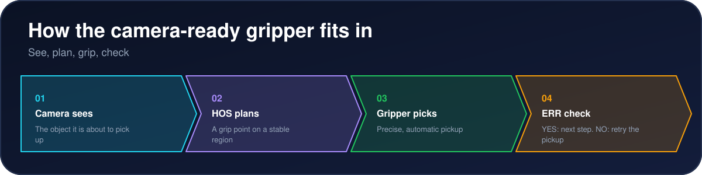
</p>


Full specs, STL files, and setup notes will be added to the [Hardware](https://github.com/Aarav-111/Humanoid-Operating-System/tree/main/Hardware) folder.

---

## Why HOS

Robots in homes and workspaces need more than a fixed sequence of moves. They need to read a changing scene, reason about the outcome, decide whether a move is feasible, and show that decision to an operator before motion starts. HOS connects perception, planning, simulation, and hardware control, with clear review points at each step.

<p align="center">
  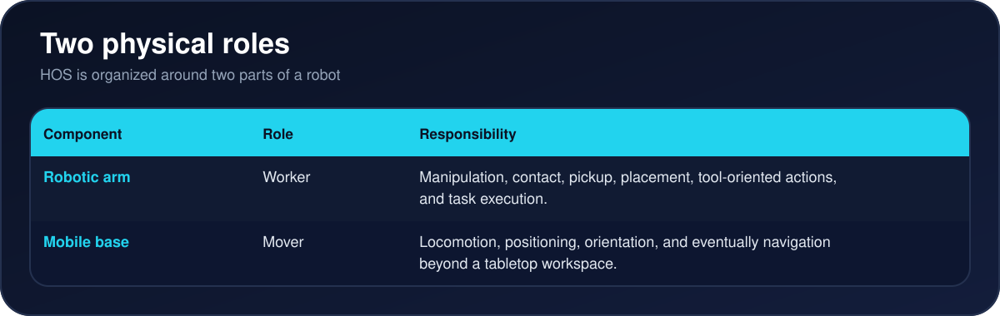
</p>


---

## Recent Updates

<p align="center">
  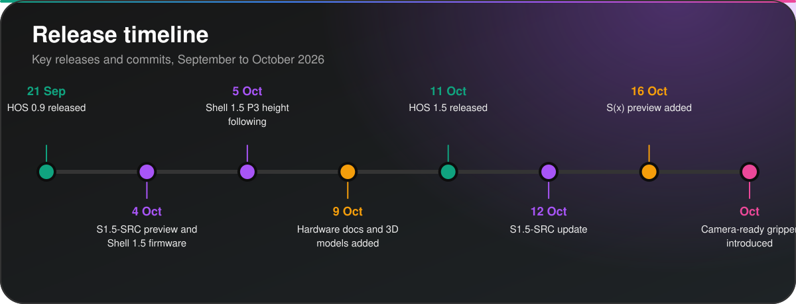
</p>


### 25 October 2026: Hardware docs cleanup

- The older hardware PDF (HOS-Trigonometry-1.5-Hardware-Documentation.pdf) was removed ([cfeff2c](https://github.com/Aarav-111/Humanoid-Operating-System/commit/cfeff2c8f5a3eaaa2eb5e74815dc2e996cb8c893)).
- The current hardware guide is [HOS-Trigonometry-1.5 Hardware Documentation (updated v2)](https://github.com/Aarav-111/Humanoid-Operating-System/blob/main/Hardware/HOS-Trigonometry-1.5_Hardware-Documentation(updated%20v2).pdf.pdf) in the Hardware folder. The file index now links to it.

### 19 October 2026: S(x)-Src-Preview-3 (HOS X)

- The S(x) preview file is now [S(x)-Src-Preview-3.py](https://github.com/Aarav-111/Humanoid-Operating-System/blob/main/Software/S(x)-Src-Preview-3.py). It was renamed from S(x)-Src-Preview.py through Preview-1 and Preview-2 ([9ca4149](https://github.com/Aarav-111/Humanoid-Operating-System/commit/9ca4149), [bf82d60](https://github.com/Aarav-111/Humanoid-Operating-System/commit/bf82d60), [384c4e0](https://github.com/Aarav-111/Humanoid-Operating-System/commit/384c4e0)).
- New in the app: a micro trigonometry correction panel, a support camera view, a time-of-flight (ToF) sensor monitor and pickup check, a grip reachability check, a magnifier, a light and dark theme toggle, and chat prompts for missing task details.
- It is a preview build and the code changes often. Install the packages it imports before you run it.

### 18 October 2026: Funding links

- The repository now has a [FUNDING.yml](https://github.com/Aarav-111/Humanoid-Operating-System/blob/main/.github/FUNDING.yml) file, so GitHub shows a Sponsor button. Supported platforms: GitHub Sponsors (Aarav-111) and Patreon (ProlabsRobotics) ([186e5bd](https://github.com/Aarav-111/Humanoid-Operating-System/commit/186e5bd1fa658e99c8ce71e88ca4ca94ae9d79b6)).

### 17 October 2026: License update

- The [LICENSE](https://github.com/Aarav-111/Humanoid-Operating-System/blob/main/LICENSE) file is now the standard MIT License. The non-commercial clause was removed ([3f5f257](https://github.com/Aarav-111/Humanoid-Operating-System/commit/3f5f257783e1aae8fdec38a778f892bcabffdb67)).

### 17 October 2026: HOS X

HOS X is about bringing the robot into real-world applications.

Product Hunt: [HOS on Product Hunt](https://www.producthunt.com/products/humanoid-operating-system)

### 12 October 2026: S1.5-SRC update

- A new **Re-execute** button in the main window runs the current plan again from the top. If a run is in progress, it stops and restarts. It stays greyed out until a plan is ready.
- The Re-execute button takes the place of the old Vision AI Sequence button. The Vision AI Sequence still runs after an operator NO on a pickup.
- When the AprilTag comes back into view on the way back, the gantry now moves up (uq) for one more second before labelling.
- Commit: [3a3e359](https://github.com/Aarav-111/Humanoid-Operating-System/commit/3a3e359)

Full commit history is on the [commits page](https://github.com/Aarav-111/Humanoid-Operating-System/commits/main).

---

## System Architecture

<p align="center">
  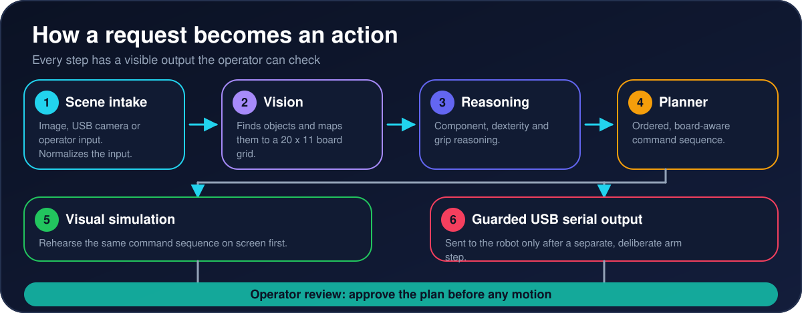
</p>


<p align="center">
  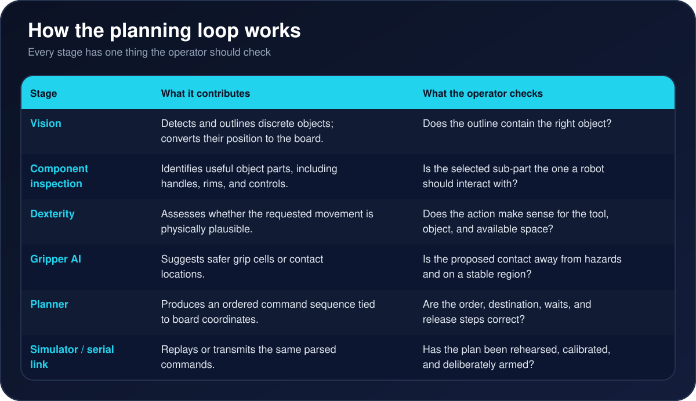
</p>


<p align="center">
  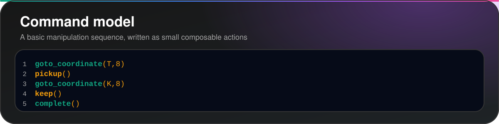
</p>


<p align="center">
  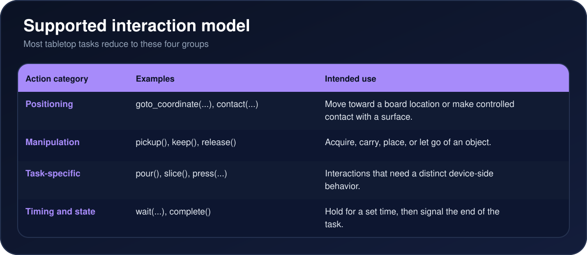
</p>


---

## Navigate This Repository

<table align="center">
  <tr>
    <td align="center" width="33%"><a href="https://github.com/Aarav-111/Humanoid-Operating-System/tree/main/Software">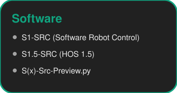</a></td>
    <td align="center" width="33%"><a href="https://github.com/Aarav-111/Humanoid-Operating-System/tree/main/Hardware">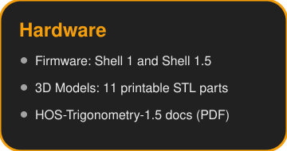</a></td>
    <td align="center" width="33%"><a href="https://github.com/Aarav-111/Humanoid-Operating-System/tree/main/Simulation">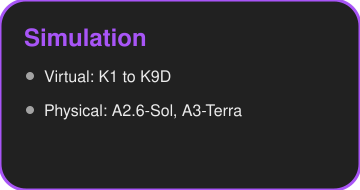</a></td>
  </tr>
  <tr>
    <td align="center" width="33%"><a href="https://github.com/Aarav-111/Humanoid-Operating-System/tree/main/Benchmarks">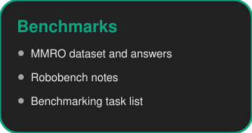</a></td>
    <td align="center" width="33%"><a href="https://github.com/Aarav-111/Humanoid-Operating-System/tree/main/assets">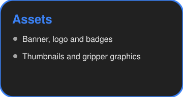</a></td>
    <td align="center" width="33%"><a href="https://github.com/Aarav-111/Humanoid-Operating-System/blob/main/LICENSE"></a></td>
  </tr>
</table>


| Folder | What you will find | Open |
| --- | --- | --- |
| README.md | Purpose, architecture, roadmap, history, benchmarks, team | [View](https://github.com/Aarav-111/Humanoid-Operating-System/blob/main/README.md) |
| Software | S1-SRC, S1.5-SRC and the S(x) preview (HOS X, Preview-3) | [Open folder](https://github.com/Aarav-111/Humanoid-Operating-System/tree/main/Software) |
| Hardware | Firmware, hardware docs and 3D models | [Open folder](https://github.com/Aarav-111/Humanoid-Operating-System/tree/main/Hardware) |
| Simulation/Virtual | K1 to K9D virtual simulators | [Open folder](https://github.com/Aarav-111/Humanoid-Operating-System/tree/main/Simulation/Virtual) |
| Simulation/Physical | A2.6-Sol and A3-Terra | [Open folder](https://github.com/Aarav-111/Humanoid-Operating-System/tree/main/Simulation/Physical) |
| Benchmarks | MMRO dataset, Robobench and task list | [Open folder](https://github.com/Aarav-111/Humanoid-Operating-System/tree/main/Benchmarks) |


### File index

Click any file to open it on GitHub.

| Folder | Files |
| --- | --- |
| Software | [S1-SRC.py](https://github.com/Aarav-111/Humanoid-Operating-System/blob/main/Software/S1-SRC.py) [S1.5-SRC.py](https://github.com/Aarav-111/Humanoid-Operating-System/blob/main/Software/S1.5-SRC.py) [S(x)-Src-Preview-3.py](https://github.com/Aarav-111/Humanoid-Operating-System/blob/main/Software/S(x)-Src-Preview-3.py) |
| Hardware/Firmware | [Shell_1.ino](https://github.com/Aarav-111/Humanoid-Operating-System/blob/main/Hardware/Firmware/Shell_1.ino) [Shell_1.5.ino](https://github.com/Aarav-111/Humanoid-Operating-System/blob/main/Hardware/Firmware/Shell_1.5.ino) |
| Hardware (docs) | [HOS-Trigonometry-1.5 Hardware Documentation, updated v2 (PDF)](https://github.com/Aarav-111/Humanoid-Operating-System/blob/main/Hardware/HOS-Trigonometry-1.5_Hardware-Documentation(updated%20v2).pdf.pdf) |
| Hardware/3D Models | [apriltag-connector](https://github.com/Aarav-111/Humanoid-Operating-System/blob/main/Hardware/3D%20Models/apriltag-connector.stl) [basic-robot](https://github.com/Aarav-111/Humanoid-Operating-System/blob/main/Hardware/3D%20Models/basic-robot.stl) [gripper-part-1](https://github.com/Aarav-111/Humanoid-Operating-System/blob/main/Hardware/3D%20Models/gripper-part-1.stl) [gripper-part-2-sponge](https://github.com/Aarav-111/Humanoid-Operating-System/blob/main/Hardware/3D%20Models/gripper-part-2-sponge.stl) [hub](https://github.com/Aarav-111/Humanoid-Operating-System/blob/main/Hardware/3D%20Models/hub.stl) [l-bracket](https://github.com/Aarav-111/Humanoid-Operating-System/blob/main/Hardware/3D%20Models/l-bracket.stl) [legs](https://github.com/Aarav-111/Humanoid-Operating-System/blob/main/Hardware/3D%20Models/legs.stl) [pulley-mount](https://github.com/Aarav-111/Humanoid-Operating-System/blob/main/Hardware/3D%20Models/pulley-mount.stl) [xy-interaxis-connector](https://github.com/Aarav-111/Humanoid-Operating-System/blob/main/Hardware/3D%20Models/xy-interaxis-connector.stl) [y-axis-holder](https://github.com/Aarav-111/Humanoid-Operating-System/blob/main/Hardware/3D%20Models/y-axis-holder.stl) [z-axis-mounter](https://github.com/Aarav-111/Humanoid-Operating-System/blob/main/Hardware/3D%20Models/z-axis-mounter.stl) |
| Simulation/Virtual | [K1](https://github.com/Aarav-111/Humanoid-Operating-System/blob/main/Simulation/Virtual/K1.py) [K1.5](https://github.com/Aarav-111/Humanoid-Operating-System/blob/main/Simulation/Virtual/K1.5.py) [K3D](https://github.com/Aarav-111/Humanoid-Operating-System/blob/main/Simulation/Virtual/K3D.py) [K3.5D](https://github.com/Aarav-111/Humanoid-Operating-System/blob/main/Simulation/Virtual/K3.5D.py) [K5D](https://github.com/Aarav-111/Humanoid-Operating-System/blob/main/Simulation/Virtual/K5D.py) [K9D](https://github.com/Aarav-111/Humanoid-Operating-System/blob/main/Simulation/Virtual/K9D.py) |
| Simulation/Physical | [A2.6-Sol.py](https://github.com/Aarav-111/Humanoid-Operating-System/blob/main/Simulation/Physical/A2.6-Sol.py) [A3-Terra.py](https://github.com/Aarav-111/Humanoid-Operating-System/blob/main/Simulation/Physical/A3-Terra.py) |
| Benchmarks | [MMRO_Questions.json](https://github.com/Aarav-111/Humanoid-Operating-System/blob/main/Benchmarks/MMRO/Dataset/MMRO_Questions.json) [K5D_Answers.json](https://github.com/Aarav-111/Humanoid-Operating-System/blob/main/Benchmarks/MMRO/Dataset/K5D_Answers.json) [Why Choose the MMRO Benchmark](https://github.com/Aarav-111/Humanoid-Operating-System/blob/main/Benchmarks/MMRO/Why%20Choose%20the%20MMRO%20Benchmark.md) [Robobench_benchmark.md](https://github.com/Aarav-111/Humanoid-Operating-System/blob/main/Benchmarks/Robobench/Robobench_benchmark.md) [Benchmarking-tasks.md](https://github.com/Aarav-111/Humanoid-Operating-System/blob/main/Benchmarks/Benchmarking-tasks.md) |
| Root | [LICENSE](https://github.com/Aarav-111/Humanoid-Operating-System/blob/main/LICENSE) [README.md](https://github.com/Aarav-111/Humanoid-Operating-System/blob/main/README.md) |

Quick links: [Software](https://github.com/Aarav-111/Humanoid-Operating-System/tree/main/Software) | [Hardware](https://github.com/Aarav-111/Humanoid-Operating-System/tree/main/Hardware) | [Firmware](https://github.com/Aarav-111/Humanoid-Operating-System/tree/main/Hardware/Firmware) | [3D Models](https://github.com/Aarav-111/Humanoid-Operating-System/tree/main/Hardware/3D%20Models) | [Simulation/Virtual](https://github.com/Aarav-111/Humanoid-Operating-System/tree/main/Simulation/Virtual) | [Simulation/Physical](https://github.com/Aarav-111/Humanoid-Operating-System/tree/main/Simulation/Physical) | [Benchmarks](https://github.com/Aarav-111/Humanoid-Operating-System/tree/main/Benchmarks)

1. [Read the README](https://github.com/Aarav-111/Humanoid-Operating-System/blob/main/README.md)
2. [Simulation/Virtual](https://github.com/Aarav-111/Humanoid-Operating-System/tree/main/Simulation/Virtual): see how planning evolved
3. [Simulation/Physical](https://github.com/Aarav-111/Humanoid-Operating-System/tree/main/Simulation/Physical): trace intake to serial output
4. [Hardware](https://github.com/Aarav-111/Humanoid-Operating-System/tree/main/Hardware): check firmware and setup before connecting
5. [Benchmarks](https://github.com/Aarav-111/Humanoid-Operating-System/tree/main/Benchmarks): reproduce evaluations


---

## Run It From the Terminal

You need Git and Python 3. Hardware steps need the Arduino IDE or `arduino-cli`.

### Clone the whole repository

```bash
git clone https://github.com/Aarav-111/Humanoid-Operating-System.git
cd Humanoid-Operating-System
```

### Download a single file

Use the raw link. Replace the path with the file you want.

```bash
curl -L -O https://raw.githubusercontent.com/Aarav-111/Humanoid-Operating-System/main/Software/S1.5-SRC.py
```

Or with `wget`:

```bash
wget https://raw.githubusercontent.com/Aarav-111/Humanoid-Operating-System/main/Software/S1.5-SRC.py
```

### Download one folder only

```bash
git clone --depth 1 --filter=blob:none --sparse https://github.com/Aarav-111/Humanoid-Operating-System.git
cd Humanoid-Operating-System
git sparse-checkout set Hardware/3D%20Models
```

### Run the Python software

Install the packages imported at the top of the file you run, then start it:

```bash
python3 -m venv .venv
source .venv/bin/activate
pip install openai opencv-python numpy pyserial
export OPENAI_API_KEY="your-key-here"
python3 Software/S1.5-SRC.py
```

The AI stages need your own OpenAI key. Never commit it to the repository.

### Flash the firmware

Open `Hardware/Firmware/Shell_1.5.ino` in the Arduino IDE, select your board and port, then upload. Use `Shell_1.ino` for the older Shell 1 build.

### Get the 3D parts

Download the STL files from [Hardware/3D Models](https://github.com/Aarav-111/Humanoid-Operating-System/tree/main/Hardware/3D%20Models), or use the sparse-checkout command above.

---

## Simulator History

<p align="center">
  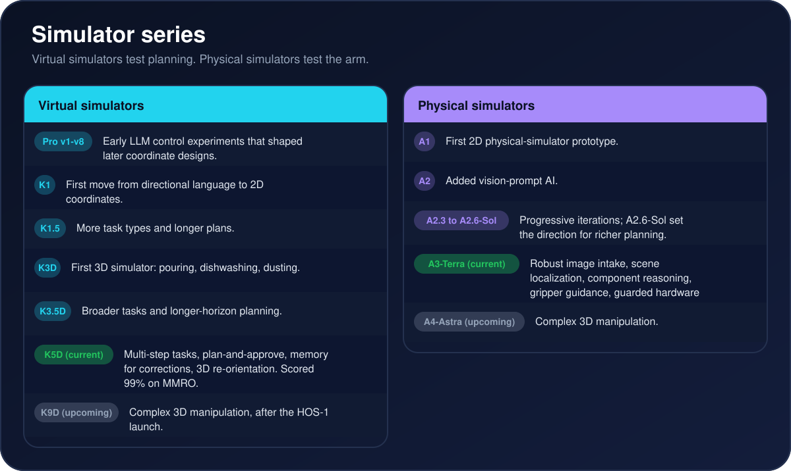
</p>


---

## Roadmap for 2026

<p align="center">
  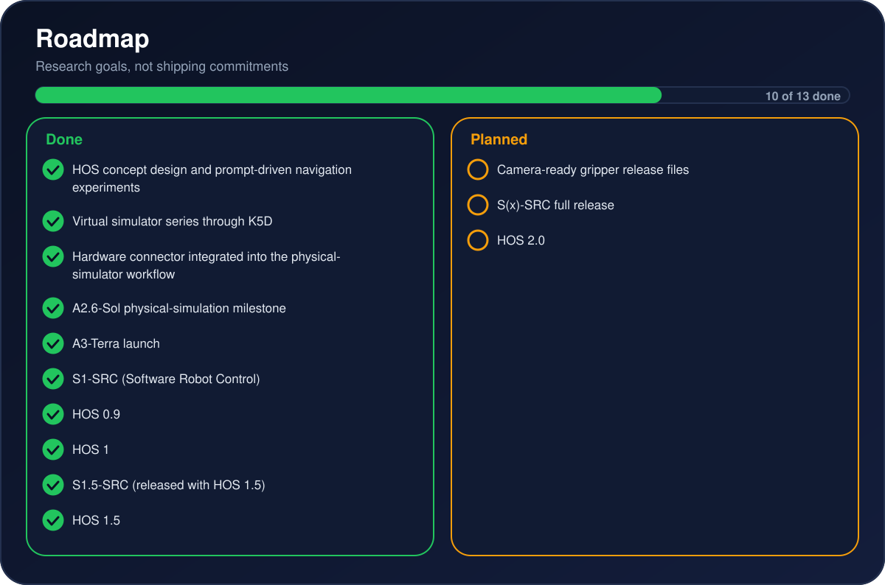
</p>


<p align="center">
  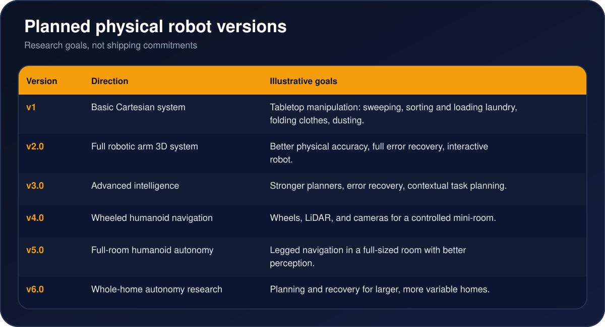
</p>


---

## Benchmarking

<p align="center">
  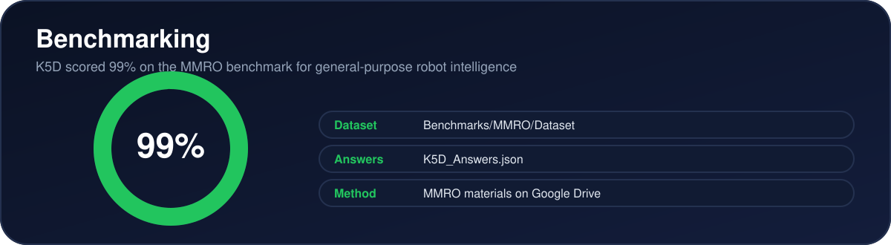
</p>


---

## Running Cost

<p align="center">
  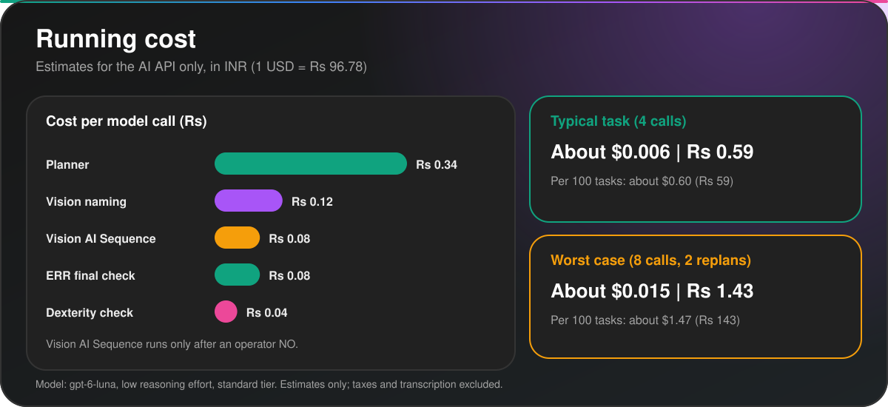
</p>


All numbers below are **estimates**, not measured bills. They cover the AI API only.

| Item | Model calls | USD (est.) | INR (est.) |
| --- | --- | --- | --- |
| Planner call | 1 | $0.0035 | Rs 0.34 |
| Vision naming call (2 photos) | 1 | $0.0013 | Rs 0.12 |
| ERR final check call (1 photo) | 1 | $0.0009 | Rs 0.08 |
| Vision AI Sequence call (only after an operator NO) | 1 | $0.0009 | Rs 0.08 |
| Dexterity check call | 1 | $0.0005 | Rs 0.04 |
| Typical task, no failures | 4 | about $0.006 | about Rs 0.59 |
| Typical, per 100 tasks | 400 | about $0.60 | about Rs 59 |
| Worst case task, 2 replans | 8 | about $0.015 | about Rs 1.43 |
| Worst case, per 100 tasks | 800 | about $1.47 | about Rs 143 |

**What HOS calls:** OpenAI API with your own key. Model `gpt-6-luna` for planning, vision naming, dexterity, ERR and Vision AI Sequence, at `low` reasoning effort, standard tier. Replanning is limited to 2 automatic attempts. Optional voice input uses `gpt-4o-transcribe` (fallback `whisper-1`) and is not included.

**Price used:** `gpt-6-luna` standard tier, $0.10 per 1M input tokens and $0.50 per 1M output tokens. Source: [OpenAI API pricing](https://developers.openai.com/api/docs/pricing), checked 18 October 2026 (same as on 11 October 2026). Exchange rate: 1 USD = Rs 96.78 (10 October 2026).

**Assumptions:** about 20,000 input and 3,000 output tokens for the planner, 5,000 in and 1,500 out for vision naming, 3,500 in and 1,000 out for ERR and Vision AI Sequence, 2,000 in and 500 out for dexterity. Photo token counts are rough guesses. No prompt caching. Output includes reasoning tokens. Taxes and transcription not included. Check the `[timing]` lines S1.5-SRC prints for real token counts.

**Hardware:** the hardware docs list parts but no prices, so no hardware cost is given. Main parts: Arduino Uno and CNC Shield V3 with A4988 drivers, NEMA 17 steppers, 12 V 10 A power supply, 2020 V-slot frame, GT2 belts and pulleys, T8 lead screw, 8 mm rods, time-of-flight and IR sensors, AprilTag 36h11 and 3D-printed parts.

Source: [Software/S1.5-SRC.py](https://github.com/Aarav-111/Humanoid-Operating-System/blob/main/Software/S1.5-SRC.py), first worked out at commit [7fe076e](https://github.com/Aarav-111/Humanoid-Operating-System/commit/7fe076e6622cab2954850d361ee9b7810eea0f29) and rechecked at [3a3e359](https://github.com/Aarav-111/Humanoid-Operating-System/commit/3a3e359) (no change to models or call count).

---

## Hardware

<p align="center">
  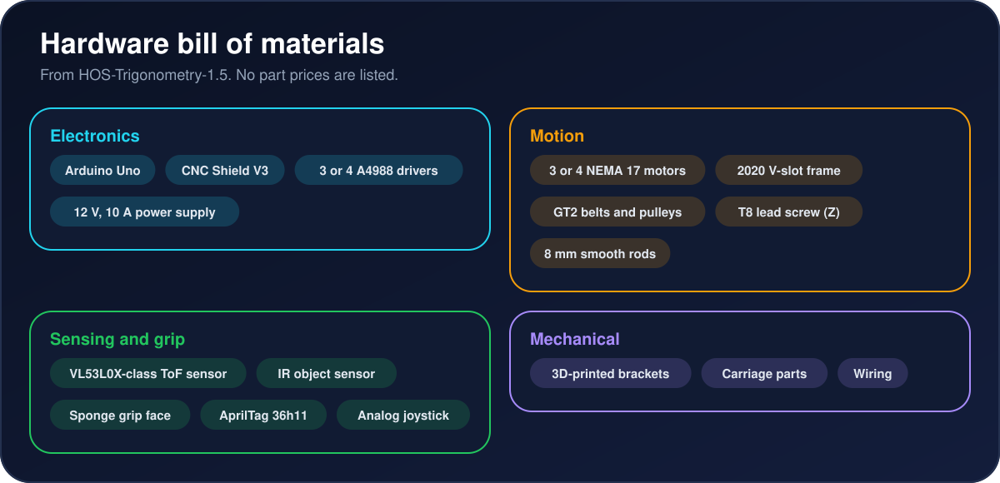
</p>


---

## Safety and Responsible Use

<p align="center">
  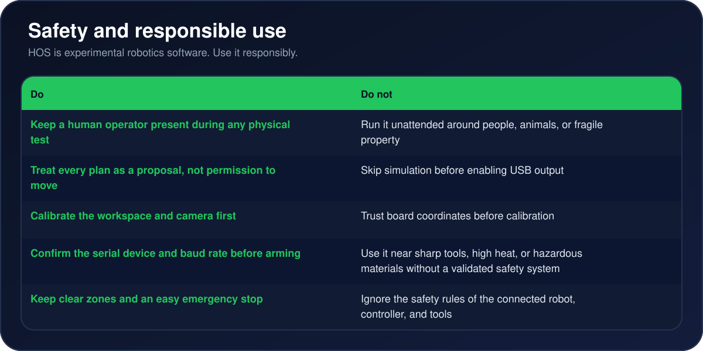
</p>


---

## Team and Contact

| Role | Name |
|---|---|
| Project Lead | Aarav Jaisingh |
| Project Co-lead | Siyona Chicker |
| Project Manager | Mathew Jose Tony |
| Collaborators | Job San Jose, Sai Sachin, Atharva Roongta, Aarush Wagh |


<p align="center">
  <a href="https://HOS.prolabsrobotics.chatgpt.site"></a>
  <a href="mailto:prolabsrobotics@gmail.com"></a>
  <a href="https://www.youtube.com/watch?v=wpmh6HE-oz8"></a>
</p>

For collaboration, research, or project questions: **prolabsrobotics@gmail.com**

---

<p align="center">
  <b>Humanoid Operating System</b><br>
  Building an inspectable path from scene understanding to supervised robot action.
</p>

---

## Links

| Link | Where |
|---|---|
| Product Hunt | [Humanoid Operating System](https://www.producthunt.com/products/humanoid-operating-system) |
| Virtual License | [Virtual License](#) |
