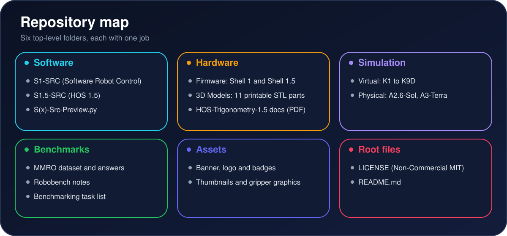
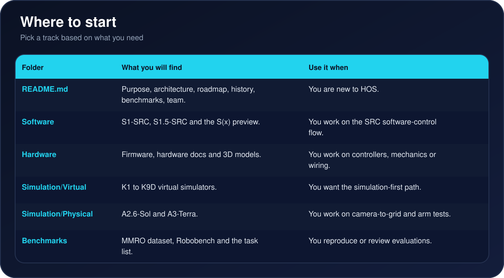
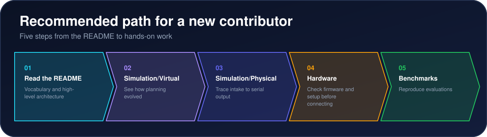
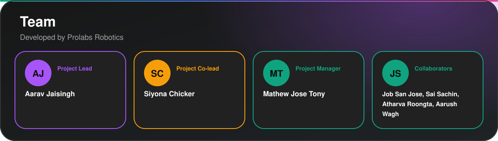

<p align="center">
  
</p>

<p align="center">
  <a href="https://github.com/Aarav-111/Humanoid-Operating-System#recent-updates"></a>
  <a href="https://github.com/Aarav-111/Humanoid-Operating-System#benchmarking"></a>
  <a href="https://github.com/Aarav-111/Humanoid-Operating-System#camera-ready-gripper"></a>
  <a href="https://github.com/Aarav-111/Humanoid-Operating-System/tree/main/Software"></a>
  <a href="https://github.com/Aarav-111/Humanoid-Operating-System/tree/main/Hardware/Firmware"></a>
  <a href="https://github.com/Aarav-111/Humanoid-Operating-System/blob/main/LICENSE"></a>
</p>

<p align="center">
  <b>Demo Videos</b> &nbsp;|&nbsp; <b>Camera-Ready Gripper</b> &nbsp;|&nbsp; <b>Architecture</b> &nbsp;|&nbsp; <b>Navigate</b> &nbsp;|&nbsp; <b>Roadmap</b> &nbsp;|&nbsp; <b>Run It</b> &nbsp;|&nbsp; <b>Team</b>
</p>

---

## Overview

> An LLM-powered control layer and modular operating system for humanoid robots.

Jensen Huang has spoken about the need for a general-purpose robot breakthrough before humanoids can scale. HOS is our attempt at that: a foundational software and hardware framework that gives humanoid robots a generalized, reasoning-driven "mind."

Instead of training isolated models per task (the approach used by most VLA models, including Gemini Robotics and pi0.5), HOS uses an LLM-driven control layer for multi-modal decision-making. This repository covers the full HOS system: the mobile base for locomotion and the robotic arm for manipulation.

<p align="center">
  
</p>


**Status:** HOS 1.5 released (11 October 2026). Active research and prototyping continue. Built by Prolabs Robotics, Bengaluru, India.

---

## Demo Videos

<table align="center">
  <tr>
    <td align="center" width="50%">
      <a href="https://www.youtube.com/watch?v=wpmh6HE-oz8">
        
      </a>
      <br><b>HOS 1.5 task compilation</b><br>11 October 2026
    </td>
    <td align="center" width="50%">
      <a href="https://youtu.be/9Af5JZoZxco">
        
      </a>
      <br><b>HOS 0.9 launch</b><br>21 September 2026
    </td>
  </tr>
</table>

---

## Camera-Ready Gripper

We are introducing the **camera-ready gripper**, a super precise gripper built for **automatic pickup**.

<p align="center">
  
</p>

<p align="center">
  
</p>


Full specs, STL files, and setup notes will be added to the [Hardware](https://github.com/Aarav-111/Humanoid-Operating-System/tree/main/Hardware) folder.

---

## Why HOS

Robots in homes and workspaces need more than a fixed sequence of moves. They need to read a changing scene, reason about the outcome, decide whether a move is feasible, and show that decision to an operator before motion starts. HOS connects perception, planning, simulation, and hardware control, with clear review points at each step.

<p align="center">
  
</p>


---

## Recent Updates

<p align="center">
  
</p>


Full commit history is on the [commits page](https://github.com/Aarav-111/Humanoid-Operating-System/commits/main).

---

## System Architecture

<p align="center">
  
</p>


<p align="center">
  
</p>


<p align="center">
  
</p>


<p align="center">
  
</p>


---

## Navigate This Repository

<p align="center">
  
</p>


<p align="center">
  
</p>


Quick links: [Software](https://github.com/Aarav-111/Humanoid-Operating-System/tree/main/Software) | [Hardware](https://github.com/Aarav-111/Humanoid-Operating-System/tree/main/Hardware) | [Firmware](https://github.com/Aarav-111/Humanoid-Operating-System/tree/main/Hardware/Firmware) | [3D Models](https://github.com/Aarav-111/Humanoid-Operating-System/tree/main/Hardware/3D%20Models) | [Simulation/Virtual](https://github.com/Aarav-111/Humanoid-Operating-System/tree/main/Simulation/Virtual) | [Simulation/Physical](https://github.com/Aarav-111/Humanoid-Operating-System/tree/main/Simulation/Physical) | [Benchmarks](https://github.com/Aarav-111/Humanoid-Operating-System/tree/main/Benchmarks)

<p align="center">
  
</p>


---

## Run It From the Terminal

You need Git and Python 3. Hardware steps need the Arduino IDE or `arduino-cli`.

### Clone the whole repository

```bash
git clone https://github.com/Aarav-111/Humanoid-Operating-System.git
cd Humanoid-Operating-System
```

### Download a single file

Use the raw link. Replace the path with the file you want.

```bash
curl -L -O https://raw.githubusercontent.com/Aarav-111/Humanoid-Operating-System/main/Software/S1.5-SRC.py
```

Or with `wget`:

```bash
wget https://raw.githubusercontent.com/Aarav-111/Humanoid-Operating-System/main/Software/S1.5-SRC.py
```

### Download one folder only

```bash
git clone --depth 1 --filter=blob:none --sparse https://github.com/Aarav-111/Humanoid-Operating-System.git
cd Humanoid-Operating-System
git sparse-checkout set Hardware/3D%20Models
```

### Run the Python software

Install the packages imported at the top of the file you run, then start it:

```bash
python3 -m venv .venv
source .venv/bin/activate
pip install openai opencv-python numpy pyserial
export OPENAI_API_KEY="your-key-here"
python3 Software/S1.5-SRC.py
```

The AI stages need your own OpenAI key. Never commit it to the repository.

### Flash the firmware

Open `Hardware/Firmware/Shell_1.5.ino` in the Arduino IDE, select your board and port, then upload. Use `Shell_1.ino` for the older Shell 1 build.

### Get the 3D parts

Download the STL files from [Hardware/3D Models](https://github.com/Aarav-111/Humanoid-Operating-System/tree/main/Hardware/3D%20Models), or use the sparse-checkout command above.

---

## Simulator History

<p align="center">
  
</p>


---

## Roadmap

<p align="center">
  
</p>


<p align="center">
  
</p>


---

## Benchmarking

<p align="center">
  
</p>


---

## Running Cost

<p align="center">
  
</p>


Source: [Software/S1.5-SRC.py](https://github.com/Aarav-111/Humanoid-Operating-System/blob/main/Software/S1.5-SRC.py) at commit [7fe076e](https://github.com/Aarav-111/Humanoid-Operating-System/commit/7fe076e6622cab2954850d361ee9b7810eea0f29).

---

## Hardware

<p align="center">
  
</p>


---

## Safety and Responsible Use

<p align="center">
  
</p>


---

## Team and Contact

<p align="center">
  
</p>


<p align="center">
  <a href="https://HOS.prolabsrobotics.chatgpt.site"></a>
  <a href="mailto:prolabsrobotics@gmail.com"></a>
  <a href="https://www.youtube.com/watch?v=wpmh6HE-oz8"></a>
</p>

For collaboration, research, or project questions: **prolabsrobotics@gmail.com**

---

<p align="center">
  <b>Humanoid Operating System</b><br>
  Building an inspectable path from scene understanding to supervised robot action.
</p>
