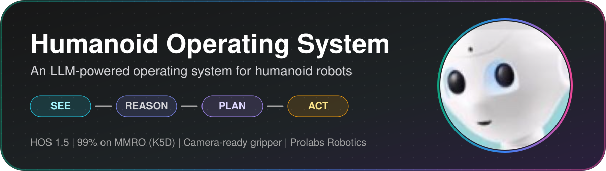
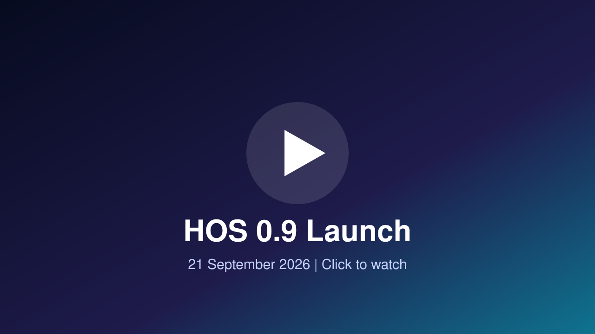
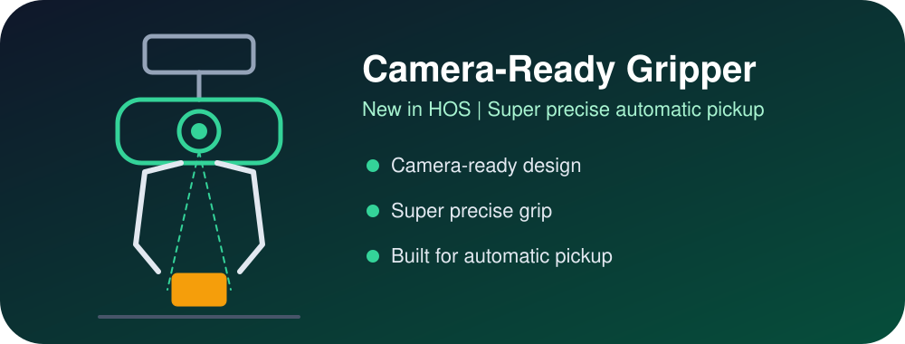
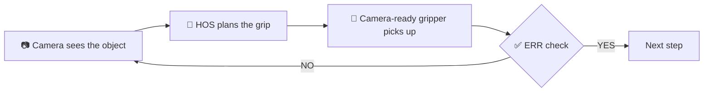
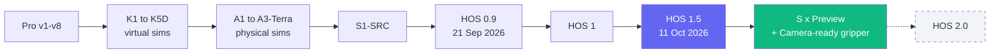
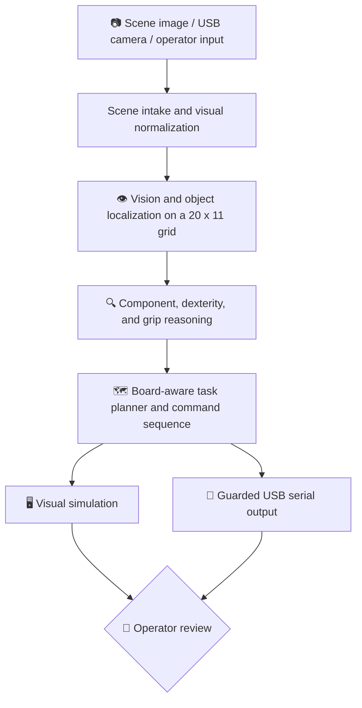
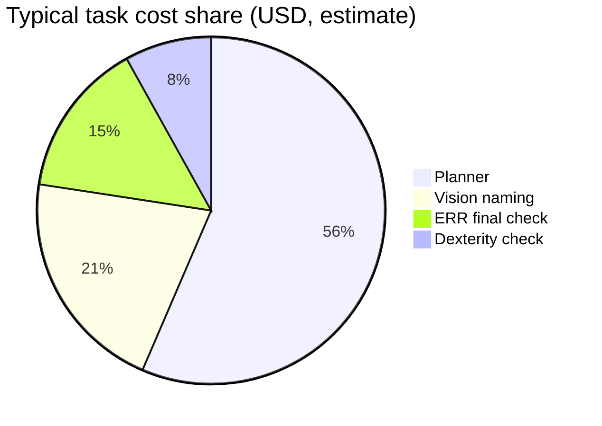

<p align="center">
  
</p>

<p align="center">
  
  
  
  
  
  
</p>

<p align="center">
  <a href="#-demo-videos"><b>Demo Videos</b></a> &nbsp;|&nbsp;
  <a href="#-new-camera-ready-gripper"><b>Camera-Ready Gripper</b></a> &nbsp;|&nbsp;
  <a href="#-system-architecture"><b>Architecture</b></a> &nbsp;|&nbsp;
  <a href="#-navigate-this-repository"><b>Navigate</b></a> &nbsp;|&nbsp;
  <a href="#-roadmap"><b>Roadmap</b></a> &nbsp;|&nbsp;
  <a href="#-team-and-contact"><b>Contact</b></a>
</p>

---

## Overview

> **An LLM-powered control layer and modular operating system for humanoid robots.**

Jensen Huang has spoken about the need for a general-purpose robot breakthrough before humanoids can scale. HOS is our attempt at that: a foundational software and hardware framework that gives humanoid robots a generalized, reasoning-driven "mind."

Instead of training isolated models per task (the approach used by most VLA models, including Gemini Robotics and π0.5), HOS uses an LLM-driven control layer for multi-modal decision-making. This repository covers the full HOS system: the mobile base for locomotion and spatial movement, and the robotic arm for manipulation.

| | |
|---|---|
| **Status** | HOS 1.5 released (11 October 2026). Active research and prototyping continue. |
| **Newest hardware** | Camera-ready gripper, a super precise gripper for automatic pickup |
| **Newest software** | `S(x)-Src-Preview.py` added on 16 October 2026 |
| **Benchmark** | K5D scored **99% on MMRO** |
| **Built by** | Prolabs Robotics, Bengaluru, India |

---

## Table of Contents

| Learn | Build | Measure | Connect |
|---|---|---|---|
| [Why HOS](#-why-hos) | [Camera-Ready Gripper](#-new-camera-ready-gripper) | [Benchmarking](#-benchmarking) | [Demo Videos](#-demo-videos) |
| [Recent Updates](#-recent-updates) | [System Architecture](#-system-architecture) | [Running Cost](#-running-cost) | [Team and Contact](#-team-and-contact) |
| [Release Timeline](#-release-timeline) | [Planning Loop](#-how-the-planning-loop-works) | [Safety](#-safety-and-responsible-use) | |
| [Simulator History](#-simulator-history) | [Navigate this Repo](#-navigate-this-repository) | [Roadmap](#-roadmap) | |

---

## 🎬 Demo Videos

<table>
  <tr>
    <td align="center" width="50%">
      <a href="https://www.youtube.com/watch?v=wpmh6HE-oz8">
        
      </a>
      <br><b>HOS 1.5 task compilation</b><br>11 October 2026
    </td>
    <td align="center" width="50%">
      <a href="https://youtu.be/9Af5JZoZxco">
        
      </a>
      <br><b>HOS 0.9 launch</b><br>21 September 2026
    </td>
  </tr>
</table>

HOS 0.9 showed five tasks with one system: sweeping, folding clothes, separating black and white laundry, dusting surfaces, and dipping, pressing, and applying soap to a plate.

---

## 🦾 New: Camera-Ready Gripper

<p align="center">
  
</p>

We are introducing the **camera-ready gripper**, a super precise gripper built for **automatic pickup**.

| Feature | Why it matters |
|---|---|
| **Camera-ready** | Built to work with the HOS camera pipeline |
| **Super precise** | Accurate grip placement on the target object |
| **Automatic pickup** | Fits the HOS see, plan, and act loop with less manual help |

How it fits into HOS:



> Full specs, STL files, and setup notes for the camera-ready gripper will be added to the [Hardware](https://github.com/Aarav-111/Humanoid-Operating-System/tree/main/Hardware) folder.

---

## 💡 Why HOS

Robots operating in homes and workspaces need more than a fixed sequence of moves. They need to interpret a changing scene, reason about the requested outcome, understand which part of an object is actionable, decide whether a move is feasible, and make that decision visible to an operator before motion starts.

HOS explores that control problem through an LLM-driven orchestration layer. The goal is not to claim that an LLM alone solves robotics; the goal is to give an operator a coherent workflow that connects perception, planning, simulation, and hardware control while preserving clear review points.

HOS is organized around two physical roles:

| Component | Role | Responsibility |
| --- | --- | --- |
| 🦾 **Robotic arm** | Worker | Manipulation, contact, pickup, placement, tool-oriented actions, and task execution. |
| 🛞 **Mobile base** | Mover | Locomotion, positioning, orientation, and eventually navigation beyond a tabletop workspace. |

The A-series physical simulators concentrate first on the arm-and-workspace layer: a bounded, camera-visible scene where perception and action can be measured, rehearsed, and improved before deployment to a broader robot platform.

### HOS 1.5 is much cheaper than HOS 1

| Stage | Cost drop vs HOS 1 |
|---|---|
| 👁️ Vision AI | **1000x cheaper** |
| 🗺️ Task planner | **8x cheaper** |
| 🔁 ERR | **3x cheaper** |

---

## 🆕 Recent Updates

| Date | Update |
|---|---|
| **16 Oct 2026** | Added [`Software/S(x)-Src-Preview.py`](https://github.com/Aarav-111/Humanoid-Operating-System/blob/main/Software/S(x)-Src-Preview.py), a preview of the next SRC generation. It adds FastSAM object outlining and saved gripper offset settings. |
| **Oct 2026** | Introducing the **camera-ready gripper** for precise automatic pickup. |
| **12 Oct 2026** | Updated [`S1.5-SRC.py`](https://github.com/Aarav-111/Humanoid-Operating-System/blob/main/Software/S1.5-SRC.py). |
| **11 Oct 2026** | Large S1.5-SRC update (about 5,600 lines added, 1,100 removed). All AI stages now use OpenAI `gpt-6-luna` at low reasoning effort (the planner used `gpt-5.6-terra` and vision naming used `gpt-5.4-mini` before). ERR on the Go is on by default: after each pickup the operator gets YES / NO, and NO runs the new Vision AI Sequence (park, look again, re-name the objects, retry the pickup). The final ERR check is on by default, with an optional ERR redo (off by default, at most 2). Also added: saved automatic gripper timing, an AprilTag search when the tag is out of view, and placement handling for words such as "between", "line up", and "side". ([7fe076e](https://github.com/Aarav-111/Humanoid-Operating-System/commit/7fe076e6622cab2954850d361ee9b7810eea0f29)) |
| **11 Oct 2026** | 🚀 **HOS 1.5 released.** It brings together S1.5-SRC software, Shell 1.5 firmware, HOS-Trigonometry-1.5 hardware documentation, and the 3D-printable models. |
| **11 Oct 2026** | Published the [HOS 1.5 task compilation](https://www.youtube.com/watch?v=wpmh6HE-oz8) demo video. |
| **9 Oct 2026** | Added [3D Models](https://github.com/Aarav-111/Humanoid-Operating-System/tree/main/Hardware/3D%20Models): AprilTag connector, basic robot, gripper parts (including a sponge gripper part), hub, L-bracket, legs, pulley mount, XY inter-axis connector, Y-axis holder, and Z-axis mounter. ([639e62a](https://github.com/Aarav-111/Humanoid-Operating-System/commit/639e62aad5e9a11a8b92fb78df90f71074acb815)) |
| **8 to 9 Oct 2026** | Added HOS-Trigonometry-1.5 hardware documentation, including an updated v2 file. ([ed2d997](https://github.com/Aarav-111/Humanoid-Operating-System/commit/ed2d997), [3b786a4](https://github.com/Aarav-111/Humanoid-Operating-System/commit/3b786a4)) |
| **7 to 8 Oct 2026** | Renamed `S1.5-SRC-Preview.py` to `S1.5-SRC.py` and expanded the source. ([d3a7a41](https://github.com/Aarav-111/Humanoid-Operating-System/commit/d3a7a41), [bfbd408](https://github.com/Aarav-111/Humanoid-Operating-System/commit/bfbd408)) |
| **5 Oct 2026** | Shell 1.5 firmware gained P3 continuous height following with sensor-based pause and recovery, plus Z steps per mm based on the 8 mm lead screw. ([2929d86](https://github.com/Aarav-111/Humanoid-Operating-System/commit/2929d86)) |
| **4 Oct 2026** | Added the S1.5-SRC preview (live-camera ERR-3 verification, a cannot-verify verdict, optional step or task checks, and failed-step replanning limited to two automatic attempts) and Shell 1.5 firmware (VL53L0X distance sensing, saved distance targets, distance telemetry). |
| **21 Sep 2026** | 🚀 **HOS 0.9 released** with a much stronger vision-prompt AI, 99% accuracy in our testing, and all 10 tasks in our benchmark suite completed. [Watch](https://youtu.be/9Af5JZoZxco) |

<details>
<summary><b>HOS 1.5 hardware and firmware details</b></summary>

<br>

[Shell 1.5 firmware](https://github.com/Aarav-111/Humanoid-Operating-System/blob/main/Hardware/Shell_1.5.ino) adds P3 continuous height following: the Z axis tracks a saved VL53L0X distance target, pauses Z and XY on missing or stale sensor readings, and rejects targets below 35 mm. Z travel is calculated from the confirmed 8 mm lead screw. The [Hardware](https://github.com/Aarav-111/Humanoid-Operating-System/tree/main/Hardware) folder includes HOS-Trigonometry-1.5 hardware documentation (PDF) and [3D Models](https://github.com/Aarav-111/Humanoid-Operating-System/tree/main/Hardware/3D%20Models) with printable STL parts for the gantry, gripper, and AprilTag connector. The release does not by itself prove hardware reliability.

</details>

---

## 📅 Release Timeline



---

## 🧠 System Architecture



Each stage has a distinct job:

| # | Stage | What it does |
|---|---|---|
| 1 | **Scene intake** | Loads a supported image or starts a live camera feed. Normalizes common real-world input variations, including grayscale, RGBA, and higher-bit-depth images. |
| 2 | **Vision** | Identifies discrete objects and maps their observed location to a fixed 20 x 11 board grid. |
| 3 | **Component reasoning** | Focuses on actionable parts, such as a handle, rim, button, or control surface, rather than treating the entire object as a single target. |
| 4 | **Dexterity and gripper reasoning** | Evaluates whether the interaction is plausible and helps select a safer contact or grip location. |
| 5 | **Planning** | Turns the operator's requested outcome into an ordered sequence of board-aware actions. If an object is missing from the scene, the system reports that instead of inventing a location. |
| 6 | **Simulation and hardware output** | Use the same parsed command sequence. The simulator is the default rehearsal surface; USB output is a separately armed action. |

---

## 🔁 How the Planning Loop Works

The planning loop is intentionally layered. The operator's request is grounded against the observed scene instead of being handled as a generic text completion.

| Stage | What it contributes | What the operator should check |
| --- | --- | --- |
| **Vision** | Detects and outlines discrete objects; converts their position to the board. | Does the outline contain the right object? |
| **Component inspection** | Identifies useful object parts, including handles, rims, and controls. | Is the selected sub-part the one a robot should interact with? |
| **Dexterity** | Assesses whether the requested movement is physically plausible. | Does the action make sense for the tool, object, and available space? |
| **Gripper AI** | Suggests safer grip cells or contact locations. | Is the proposed contact away from hazards and on a stable region? |
| **Planner** | Produces an ordered command sequence tied to board coordinates. | Are the order, destination, waits, and release steps correct? |
| **Simulator / serial link** | Replays or transmits the same parsed commands. | Has the plan been rehearsed, calibrated, and deliberately armed? |

### Command model

HOS plans are small, composable actions. A basic manipulation sequence:

```text
goto_coordinate(T,8)
pickup()
goto_coordinate(K,8)
keep()
complete()
```

| Action category | Examples | Intended use |
| --- | --- | --- |
| **Positioning** | `goto_coordinate(...)`, `contact(...)` | Move toward a board location or make controlled contact with a surface. |
| **Manipulation** | `pickup()`, `keep()`, `release()` | Acquire, carry, place, or let go of an object. |
| **Task-specific** | `pour()`, `slice()`, `press(...)` | Interactions that need a distinct device-side behavior. |
| **Timing and state** | `wait(...)`, `complete()` | Hold for a set time, then signal the end of the task. |

The physical meaning of each command depends on the connected robot, end effector, firmware, and calibration. A plan that looks right on the board is not proof of safe motion in the real world.

---

## 🧭 Navigate this Repository

```text
Humanoid-Operating-System/
├── 📁 Software/                S1, S1.5 and S(x) preview control software
├── 📁 Hardware/
│   ├── 📁 Firmware/            Shell 1 and Shell 1.5 Arduino firmware
│   ├── 📁 3D Models/           Printable STL parts (gantry, gripper, AprilTag)
│   └── 📄 HOS-Trigonometry-1.5 hardware documentation (PDF)
├── 📁 Simulation/
│   ├── 📁 Virtual/             K-series virtual simulators (K1 to K9D)
│   └── 📁 Physical/            A-series physical simulators (A2.6-Sol, A3-Terra)
├── 📁 Benchmarks/              MMRO dataset, Robobench, benchmarking task list
├── 📁 assets/                  Images used in this README
├── 📄 LICENSE                  Non-commercial MIT license
└── 📄 README.md
```

| Start here | What you will find | When to use it |
| --- | --- | --- |
| 📖 [README.md](https://github.com/Aarav-111/Humanoid-Operating-System/blob/main/README.md) | Purpose, architecture, roadmap, history, benchmarks, team. | Begin here if you are new to HOS. |
| 💻 [Software](https://github.com/Aarav-111/Humanoid-Operating-System/tree/main/Software) | S1-SRC, S1.5-SRC and the S(x) preview. | The SRC software-control workflow. |
| 🔧 [Hardware](https://github.com/Aarav-111/Humanoid-Operating-System/tree/main/Hardware) | [Firmware](https://github.com/Aarav-111/Humanoid-Operating-System/tree/main/Hardware/Firmware), hardware docs, [3D Models](https://github.com/Aarav-111/Humanoid-Operating-System/tree/main/Hardware/3D%20Models). | Controllers, mechanics, wiring, physical setup. |
| 🖥️ [Simulation/Virtual](https://github.com/Aarav-111/Humanoid-Operating-System/tree/main/Simulation/Virtual) | K-series virtual simulators. | Understand the simulation-first path. |
| 🤖 [Simulation/Physical](https://github.com/Aarav-111/Humanoid-Operating-System/tree/main/Simulation/Physical) | A-series physical simulators. | Camera-to-grid operation and real arm tests. |
| 📊 [Benchmarks](https://github.com/Aarav-111/Humanoid-Operating-System/tree/main/Benchmarks) | MMRO dataset, Robobench, task list. | Evaluation inputs and reported results. |

### Recommended path for a new contributor


1. Read this README for the vocabulary and high-level architecture.
2. Open **Simulation/Virtual** to see how coordinate-based planning evolved before hardware tests.
3. Move to **Simulation/Physical**. Trace scene intake, grid logic, planning, simulation, and serial output in that order.
4. Review **Hardware** (firmware and docs) before connecting a simulator to a device. Keep controller, calibration, port, and safety assumptions explicit.
5. Use **Benchmarks** (dataset and task list) when discussing or reproducing a result.

<details>
<summary><b>Tips for finding your way quickly on GitHub</b></summary>

<br>

- Press `t` (**Go to file**) to jump to a known filename.
- Press `/` to search for terms such as `SerialLink`, `GridOverlay`, `AprilTag`, `AI_INSTRUCTIONS`, or a simulator version.
- Read commit history before changing a legacy simulator. A newer-looking file is not always the active one.
- Keep changes scoped to one track: simulator logic, hardware integration, and benchmark definitions should be reviewed separately.

</details>

---

## 🕹️ Simulator History

Simulation is how the HOS team tests planning behavior before using a physical robot. Some early A-series files and older Shell directories were removed from the current tree on 4 October 2026; use Git history to see them.

<table>
<tr><th>🖥️ Virtual simulator series</th><th>🤖 Physical simulator series</th></tr>
<tr><td valign="top">

| Version | Focus |
| --- | --- |
| **Pro v1-v8** | Early LLM control experiments that shaped later coordinate designs. |
| **K1** | First move from directional language to 2D coordinates. |
| **K1.5** | More task types and longer plans. |
| **K3D** | First 3D simulator: pouring, dishwashing, dusting. |
| **K3.5D** | Broader tasks, longer-horizon planning. |
| **K5D** | Current: multi-step tasks, plan-and-approve, memory for corrections, 3D re-orientation. |
| **K9D** | Upcoming: complex 3D manipulation (after HOS-1 launch). |

</td><td valign="top">

| Version | Focus |
| --- | --- |
| **A1** | First 2D physical-simulator prototype. |
| **A2** | Added vision-prompt AI. |
| **A2.3 - A2.6-Sol** | Progressive iterations; A2.6-Sol set the direction for richer planning. |
| **A3-Terra** | Current: robust image intake, scene localization, component reasoning, gripper guidance, guarded hardware link. |
| **A4-Astra** | Upcoming: complex 3D manipulation. |

</td></tr>
</table>

---

## 🗺️ Roadmap

Roadmap items are research goals, not shipping commitments.

### Platform and simulator

- [x] HOS concept design and prompt-driven navigation experiments
- [x] Virtual simulator series through K5D
- [x] Hardware connector integrated into the physical-simulator workflow
- [x] A2.6-Sol physical-simulation milestone
- [x] A3-Terra launch
- [x] S1-SRC (Software Robot Control)
- [x] HOS 0.9
- [x] HOS 1
- [x] S1.5-SRC (released with HOS 1.5)
- [x] HOS 1.5
- [ ] Camera-ready gripper release files
- [ ] S(x)-SRC full release
- [ ] HOS 2.0

### Planned physical robot versions

| Version | Direction | Illustrative goals |
| --- | --- | --- |
| **v1** | Basic Cartesian system | Tabletop manipulation: sweeping, sorting and loading laundry, folding clothes, dusting. |
| **v2.0** | Full robotic arm 3D system | Better physical accuracy, full error recovery, interactive robot. |
| **v3.0** | Advanced intelligence | Stronger planners, error recovery, contextual task planning. |
| **v4.0** | Wheeled humanoid navigation | Wheels, LiDAR, and cameras for a controlled mini-room. |
| **v5.0** | Full-room humanoid autonomy | Legged navigation in a full-sized room with better perception. |
| **v6.0** | Whole-home autonomy research | Planning and recovery for larger, more variable homes. |

---

## 📊 Benchmarking

<p align="center">
  
</p>

The K5D simulator scored **99% on the MMRO benchmark** for general-purpose robot intelligence.

- Dataset and answers: [Benchmarks/MMRO](https://github.com/Aarav-111/Humanoid-Operating-System/tree/main/Benchmarks/MMRO)
- Why MMRO: [Why Choose the MMRO Benchmark](https://github.com/Aarav-111/Humanoid-Operating-System/blob/main/Benchmarks/MMRO/Why%20Choose%20the%20MMRO%20Benchmark.md)
- Methodology and scoring: [MMRO materials](https://drive.google.com/drive/folders/1bAwEW-q3GPSAHZffDW0udatJOwSDtqaD?usp=sharing)

---

## 💰 Running Cost

All numbers are **estimates**, not measured bills. They cover the AI API only and were worked out from [`Software/S1.5-SRC.py`](https://github.com/Aarav-111/Humanoid-Operating-System/blob/main/Software/S1.5-SRC.py) at commit [7fe076e](https://github.com/Aarav-111/Humanoid-Operating-System/commit/7fe076e6622cab2954850d361ee9b7810eea0f29).

| Scenario | Model calls | Per task | Per 100 tasks |
| --- | --- | --- | --- |
| ✅ Typical (no failures) | 4 | about $0.006 / Rs 0.59 | about $0.60 / Rs 59 |
| ⚠️ Worst case (2 replans) | 8 | about $0.015 / Rs 1.43 | about $1.47 / Rs 143 |



<details>
<summary><b>Full cost breakdown and assumptions</b></summary>

<br>

**What HOS calls**

- **Provider:** OpenAI API (Chat Completions, your own API key).
- **Model:** `gpt-6-luna` for every reasoning and vision stage, at `low` reasoning effort, standard tier (priority tier off).
- **Optional voice input:** `gpt-4o-transcribe` (fallback `whisper-1`). Not included below.

**Price used:** `gpt-6-luna`, standard tier: **$0.10 per 1M input tokens**, $0.01 per 1M cached input tokens, **$0.50 per 1M output tokens**. Source: [OpenAI gpt-6-luna model page](https://developers.openai.com/api/docs/models/gpt-6-luna), checked 11 October 2026. Exchange rate: 1 USD = 96.78 INR ([dollarrupee.in](https://dollarrupee.in/), 10 October 2026).

| Call | When it runs | Tokens in (est.) | Tokens out incl. reasoning (est.) | Cost (USD) | Cost (INR) |
| --- | --- | --- | --- | --- | --- |
| Vision naming | Start of a task (2 high-detail photos) | 5,000 | 1,500 | $0.0013 | Rs 0.12 |
| Dexterity check | Once per task | 2,000 | 500 | $0.0005 | Rs 0.04 |
| Planner | Once per task (a plain sweep skips it) | 20,000 | 3,000 | $0.0035 | Rs 0.34 |
| ERR final check | End of task (1 photo) | 3,500 | 1,000 | $0.0009 | Rs 0.08 |
| Vision AI Sequence | Only after an operator NO | 3,500 | 1,000 | $0.0009 | Rs 0.08 |

ERR on the Go asks the operator YES / NO after each pickup. A YES makes no model call.

**Assumptions:** planner input of about 20,000 tokens (the size noted in the code); photo token counts are rough guesses for high-detail images; no prompt caching; output includes reasoning tokens at low effort; taxes and transcription not included. Real costs change with the task, the scene, and OpenAI pricing. Check the `[timing]` lines S1.5-SRC prints for real tokens per call.

**Hardware:** The [HOS-Trigonometry-1.5 hardware documentation](https://github.com/Aarav-111/Humanoid-Operating-System/tree/main/Hardware) has a bill of materials but no part prices. Main parts:

- Arduino Uno and CNC Shield V3, with 3 or 4 A4988 stepper drivers
- 3 or 4 NEMA 17 stepper motors and a 12 V, 10 A power supply
- 2020 V-slot frame, GT2 belts and pulleys (X and Y), T8 lead screw (Z), 8 mm smooth rods
- VL53L0X-class time-of-flight sensor, IR object sensor, sponge grip face
- Analog joystick, AprilTag 36h11, 3D-printed brackets and carriage parts, wiring

</details>

---

## 🛡️ Safety and Responsible Use

HOS is experimental robotics software. Use it responsibly.

| ✅ Do | ❌ Do not |
|---|---|
| Keep a human operator present during any physical test | Run it unattended around people, animals, or fragile property |
| Treat every plan as a proposal, not permission to move | Skip simulation before enabling USB output |
| Calibrate the workspace and camera first | Trust board coordinates before calibration |
| Confirm the serial device and baud rate before arming | Use it near sharp tools, high heat, or hazardous materials without a validated safety system |
| Keep clear zones and an easy emergency stop | Ignore the safety rules of the connected robot, controller, and tools |

---

## 👥 Team and Contact

Developed by **Prolabs Robotics**.

| Role | Name |
| --- | --- |
| Project Manager | Mathew Jose Tony |
| Project Lead | Aarav Jaisingh |
| Project Co-lead | Siyona Chicker |
| Collaborators | Job San Jose, Sai Sachin, Atharva Roongta, Aarush Wagh |

<p align="center">
  <a href="https://HOS.prolabsrobotics.chatgpt.site"></a>
  <a href="mailto:prolabsrobotics@gmail.com"></a>
  <a href="https://www.youtube.com/watch?v=wpmh6HE-oz8"></a>
</p>

For collaboration, research, or project questions: **prolabsrobotics@gmail.com**

🌐 **Website:** [HOS.prolabsrobotics.chatgpt.site](https://HOS.prolabsrobotics.chatgpt.site)

---

<p align="center">
  <b>Humanoid Operating System</b><br>
  Building an inspectable path from scene understanding to supervised robot action.
</p>
